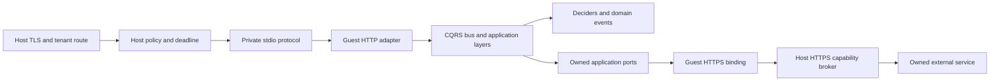

# Proposed @structure-ai/serverless package

Status: implementation-ready design proposal, not a released API. This change adds specifications only. Every TypeScript import, signature and CLI command for the future package below is **proposed** and cannot be used from the current repository. Existing package behavior is linked explicitly. No WASIX compatibility, runtime acceptance or production readiness is established by these documents.

The package lets an application keep its Effect layers, domain deciders, CQRS messages and transport-independent use cases while choosing a WASIX deployment entrypoint. The [shared contract](wasix-contract.md) owns the artifact, execution profile, capabilities, limits, wire messages and lifecycle. The [structure-infra specification](structure-infra.md) owns admission, hosting and operations. Its relative link is provisional until the companion PR lands. Shared contract changes require both implementations to update their conformance suites.

## Scope and architecture

The MVP is a bounded HTTP application, built once into a closed ESM bundle plus an approved embedded-engine WASIX runner. A warm instance serves one invocation at a time and may scale to zero. It has no general host filesystem, listener, raw network, native addon, job scheduler or durable local state. Only host-mediated public HTTPS calls cross the remote-capability boundary. A deployment is isolated by tenant, app, environment, revision, artifact, config and policy. Business tenants and user permissions remain application concerns.

The recommendation is a minimal QuickJS runner compiled to WASIX, with a small explicit Web/Effect binding layer, executed in a separately supervised native Wasmer worker. This narrows the compatibility surface and keeps JS inside guest memory. It requires implementation of the runner, event loop and bridge. Reusing the separate embedded Edge.js package may reduce porting work, but its wider Node surface requires an import/authority audit and exact version pin. Neither choice is already a verified Structure backend. The experimental Edge.js host-JS package is excluded by the [execution target](wasix-contract.md#execution-target-and-trust-boundary). Wasmtime WASI HTTP is a different target requiring a different adapter and artifact profile.



Queries remain read-only; commands name intent; business rules remain in `decide`. Domain events stay internal to a bounded context. Cross-context work remains integration events, durable outbox/inbox and idempotent consumers in the service owning the transaction. Serverless is a transport/runtime adapter, not a new domain layer or a shortcut into another context's tables. Brokered HTTP does not provide distributed transactions.

## Package surface and dependency direction

Proposed subpaths:

| Entry | Exports / purpose | Allowed dependency direction |
| --- | --- | --- |
| `@structure-ai/serverless` | `Application`, `Invocation`, `HostHttp`, tagged errors, binding/limit types | Effect, config, observability; no Bun, HTTP listener, SQL, auth or host implementation |
| `@structure-ai/serverless/http` | `fromHttpApp`, `fromHttpApi` and HTTP boundary integration | Root plus transport-neutral HTTP core and `@effect/platform`; CQRS only through existing HTTP bridge |
| `@structure-ai/serverless/wasix` | `run` and approved guest bindings | Root plus WASIX shim; only entrypoint owns execution |
| `@structure-ai/serverless/testing` | `makeHarness`, deterministic clock/entropy and capability fakes | Root; runs under Bun tests without network; cannot attest WASIX compatibility |
| `@structure-ai/serverless/build` | `build`, `inspect`, `verify` for artifacts | Host-only tooling, config and bundler/compiler ports; never imported into guest |
| `@structure-ai/serverless/cli` | `build`, `inspect`, `dev`, `verify` command definitions | Build/tooling and existing CLI package; never imported into guest |

No existing foundation package depends on serverless; no circular dependency or `http → serverless` edge is allowed. Applications compose auth and authorization just as they do today; serverless does not import them to invent a second policy system. `structure-infra` consumes the versioned contract, not guest application modules.

Current [HTTP serving](../../packages/http/src/serve.ts) and [runtime launch](../../packages/runtime/src/AppRuntime.ts) import `@effect/platform-bun`. Their current barrels are not guest-safe. Before implementation, expose a transport-neutral HTTP subpath containing API definitions, middleware, error mapping and CQRS bridge, and a runtime-core subpath for Readiness/Shutdown if reused. These are **proposed prerequisites**, not existing exports. Preserve existing public exports for Bun callers. Do not solve an accidental Bun import by providing dummy Bun globals or blindly tree-shaking platform initialization. Build graph inspection must show that guest code does not import platform-bun, Node builtins, process-global config loaders or native adapters.

The runtime-core extraction must preserve existing readiness and bounded drain semantics without importing `launch`. The guest adapter owns its instance Scope and protocol-triggered shutdown rather than installing OS signal handlers. No changes to existing packages or manifests are part of this specification PR. Implementation should introduce the prerequisites in separately reviewable changes, each updating its package docs and machine index when real exports exist. This PR deliberately adds no published-package entry to `llms.txt`.

## Public API sketches

The following proposed type-level contract keeps resource acquisition and all application dependencies explicit. It uses the existing [`Setting<A>`](../../packages/config/src/Settings.ts) shape. `Application.define` accepts a fully composed constructor: unresolved services besides Scope are a type error. Initialization errors are retained internally as typed `E`; only fixed safe error codes cross stdio.

```ts
import type { Setting } from "@structure-ai/config";
import type { Effect, Scope } from "effect";

interface Handler {
  readonly handle: (
    request: Request,
  ) => Effect.Effect<Response, RequestFailure, Invocation>;
}
interface ApplicationSpec<C, E> {
  readonly id: string;
  readonly settings: Setting<C>;
  readonly capabilities: ReadonlyArray<HttpsCapability>;
  readonly make: (config: C) => Effect.Effect<Handler, E, Scope.Scope>;
  readonly ready: (config: C) => Effect.Effect<void, E>;
}
declare const Application: {
  readonly define: <C, E>(spec: ApplicationSpec<C, E>) => ApplicationDefinition<C, E>;
};
```

`ApplicationDefinition<C, E>` is an opaque value retaining the inferred config/error types and the spec. `HttpsCapability` is the shared contract's `{ kind: "https", name, origins }` shape. `RequestFailure` is a union of the classified serverless errors below; application business failures must be mapped at their HTTP boundary. `define` validates static declarations and duplicate keys without running config loading, application effects, network or listeners at module import time. `ready` is a bounded required-resource check run after `make` and before emitting ready. If no additional probe is needed, supply `() => Effect.void`. Revision 1 forbids remote calls during initialization, so `make` and `ready` may check only local configuration, layers and resources. Required remote-service preflight must be a host admission check with its own scoped authority and timeout; an app requiring guest-side network initialization is unsupported. Runtime probes after startup belong to the handler/resource policy; a known unusable instance must retire through drain.

`Invocation` is a proposed Effect Context service with request-scoped `requestId`, `correlationId`, `remainingMs: Effect<number>`, `signal: AbortSignal` and the immutable effective limits. The handler may read it but cannot replace the host's deadline. The adapter provides it afresh on each request and removes it before warm reuse. Instance-scoped services must not capture a prior invocation. `HostHttp` is a proposed Context service supplied by the guest runtime; a handler calls `HostHttp.fetch(grant, request)` returning an Effect of bounded Response or `CapabilityDenied | DeadlineExceeded | DependencyUnavailable | BodyTooLarge`. Its service requirement is `Invocation`. Runtime owns host call IDs and never exposes a general control-plane client.

Proposed HTTP adapter shapes:

```ts
// Imports from future @structure-ai/serverless/http.
declare const fromHttpApp: (
  app: HttpApp.Default<HttpProblem, Scope.Scope>,
) => Handler;

declare const fromHttpApi: <A, E>(
  apiLayer: Layer.Layer<A | HttpApi.Api | HttpRouter.HttpRouter.DefaultServices, E>,
) => Effect.Effect<Handler, E | AdapterInitError, Scope.Scope>;
```

These sketches refer to the installed `@effect/platform` HttpApp/HttpApi/HttpRouter namespaces and Effect Layer/Scope types. `fromHttpApp` requires an already provided app. `fromHttpApi` acquires the platform services in the instance Scope, installs the same standard middleware as HTTP core, proves initialization/readiness before returning, and disposes them at drain. It must preserve the API's schemas and CQRS declared business-error 422 encoding. It cannot defer a failed layer build until the first request and still emit ready. The installed `HttpApiBuilder.toWebHandler` is a useful implementation reference, but its Promise handler and `dispose` alone do not prove startup error typing or cancellation. The adapter must retain typed initialization failures and wire AbortSignal to Effect interruption, including compound Cause behavior. No `orDie`, unsafe `_tag` casts or false `E = never` types may hide infrastructure failures.

Proposed guest entrypoint and build APIs:

```ts
// @structure-ai/serverless/wasix
declare const run: <C, E>(app: ApplicationDefinition<C, E>) => void;

// @structure-ai/serverless/build, host only
interface BuildOptions {
  readonly entry: string;
  readonly outDirectory: string;
  readonly runnerLockFile: string;
  readonly sourceRevision: string;
}
declare const build: (
  options: BuildOptions,
) => Effect.Effect<ArtifactDescriptor, BuildError>;
```

`run` is the single process boundary. It installs the approved shim, reads the private protocol, owns the Effect runtime/scope and exits deterministically. Domain/application modules never call `runPromise`, create ManagedRuntime or fork daemon work. `ArtifactDescriptor` contains verified `artifactDigest`, manifest and output location. `BuildError` is a classified permanent error with bounded safe issue codes and file locations, never config/secret values. Runner locks identify exact engine, source/toolchain and import inventory, not registry `latest` or an unconstrained engine semver.

Proposed tagged errors use `Data.TaggedError` and a readonly `classification` field. `UnsupportedRuntime`, `InvalidConfig`, `ProtocolViolation`, `CapabilityDenied`, `BodyTooLarge` and `AdapterInitError` are permanent; `DeadlineExceeded` and `DependencyUnavailable` are transient. `Cancelled` is permanent in the wire error schema but remains an interruption in Effect until the process boundary. Error objects retain safe operation IDs/codes, not raw bodies, secret URLs or external exception messages. `ProtocolViolation` is host-local and terminates an instance; it is not an accepted guest SafeFailure code. HTTP business conflicts retain the existing conflict classification and 409 mapping rather than becoming runtime errors.

## Example application and build flow

This complete **proposed minimal composition sketch** has no database, listener or network dependency. `Application`, `run` and the generated artifact are future APIs. The Settings/Effect/Schema names follow current repository APIs. It demonstrates the separation of settings, handler and process entrypoint, not a WASIX execution result.

```ts
import { Settings } from "@structure-ai/config";
import { Application } from "@structure-ai/serverless";
import { run } from "@structure-ai/serverless/wasix";
import { Effect } from "effect";

const app = Application.define({
  id: "greeting-api",
  settings: Settings.struct({ greeting: Settings.string("GREETING") }),
  capabilities: [],
  make: (config) => Effect.succeed({
    handle: (request) => Effect.succeed(
      new Response(request.method === "HEAD" ? null : config.greeting, {
        status: 200,
        headers: { "content-type": "text/plain; charset=utf-8" },
      }),
    ),
  }),
  ready: () => Effect.void,
});

run(app);
```

For a real CQRS API, keep the existing command/query definitions, deciders and handler registration in application modules. Replace the entrypoint's Bun listener with `fromHttpApi` over a fully provided API layer and the standard middleware. Replace persistence/provider implementations with explicitly supported ports. Test both transports against the same domain behavior fixtures. In particular, the guest adapter must preserve [HTTP error semantics](../../packages/http/README.md#errors): validation 400, authentication 401, permission 403, not found 404, conflict 409, declared business failure 422, throttling 429, deadline 504 and safe defect 500.

Proposed commands, **not available today**:

```sh
structure-serverless build --entry src/guest.ts --runner-lock runner.lock.json --out dist/serverless
structure-serverless inspect dist/serverless
structure-serverless verify dist/serverless
structure-serverless dev --artifact dist/serverless --config-file dev-config.json --secret-file dev-secrets.json
```

Build runs on the developer/CI host, never on a production worker. It resolves locked TypeScript dependencies, bundles ESM, rejects unresolved/dynamic/native imports and unsupported globals, includes the exact approved runner, emits the contract manifest and checks every digest. A conservative scanner cannot prove arbitrary JavaScript safety; manifest/import/runtime admission and negative execution tests remain necessary. A safe default forbids direct `eval`, `Function`, `std`/`os`, raw timers beyond the shim and arbitrary module loaders. No package manager runs in the guest.

`inspect` reports versions, files, import inventory and requested permissions without executing application code. `verify` checks bytes/schema/imports and runs local conformance fixtures in the pinned runner; its report identifies which tests actually ran. `dev` uses the same artifact and protocol with explicit local bindings. The secret file is private and never included in the artifact or watcher output; values are not passed on the command line. The developer tool validates keys, closes resources on interruption and starts no broader network grant than configured. A simulated harness is useful for fast tests but must label itself simulated. Production deployment and tenant authorization belong to structure-infra, not an SDK command that guesses credentials.

Build outputs include manifest, exact artifact digest, lock/source/toolchain identities, import report and a compatibility report. Reproducibility means repeating the same pinned build yields identical files/digest; source maps, absolute build paths, timestamps and random IDs must not perturb it. If upstream compilation is nondeterministic, record that failure and block the reproducibility gate rather than claiming build-once promotion. Promote the validated immutable bytes through environments; never rebuild with secrets or environment names.

## JavaScript and package compatibility

| Surface | MVP requirement | Current evidence / unsupported cases |
| --- | --- | --- |
| ESM, Promise, typed arrays, Map/Set | Closed bundle plus embedded engine | QuickJS documents language support; full application graph remains unproved |
| Effect scheduling | Queue microtasks, bounded setTimeout/clearTimeout, monotonic clock | Shim/event-loop integration must prove yielding, interruption, timer cleanup and no starvation |
| HTTP Web APIs | Request/Response/Headers/URL, TextEncoder/Decoder, AbortController/Signal | Explicit shim work, binary/duplicate-header/abort tests required |
| Fetch / crypto / entropy | Named `HostHttp.fetch`; secure entropy and UUID via restricted runner binding | No ambient network fetch; no blanket WebCrypto/Intl/Node crypto claim; algorithms require explicit support |
| config | Settings schemas and controlled maps, secrets Redacted | Loader graph must avoid filesystem/process imports; transport-neutral extraction may be required |
| observability | Safe structured stderr, guest metrics/log bridge | Existing native OTLP/exporter startup must be replaced; no direct collector sockets |
| domain / CQRS | Pure Effect deciders/handlers and serializable schemas | Bus internals/dependencies still require exact graph/run tests; durable idempotency stays external |
| HTTP API schemas/middleware | Future HTTP core subpath and guest adapter | Current Bun-serving barrel is not a WASIX adapter |
| runtime | Instance Scope/readiness/drain through proposed core split | `launch` / BunRuntime / OS signal listeners excluded |
| persistence/auth/jobs/storage/mail/AI SDKs | Owned ports over explicitly supported HTTPS services | Existing Bun SQLite, Bun SQL, PostgreSQL sockets, native crypto, broker drivers and filesystem adapters are not admitted by default |
| Bun / Node / npm | Build tools may use pinned Bun on the host | No Bun globals, native addons, arbitrary `node:*`, child processes or universal npm compatibility |

Each supported tuple pins SDK, Effect/platform versions, engine/runner/toolchain, Wasmer/compiler and architecture. A pure TypeScript package is not automatically portable: its transitive imports, platform globals, filesystem/crypto needs, module initialization and event-loop assumptions must pass the build and runtime gates. Browser support and host-JS support are separate follow-ups. Upstream Node compatibility marketing does not define this package's supported surface.

## Config, state and background work

Config validation precedes telemetry and application resource acquisition. Report all safe key/type issues together and fail readiness. Do not report values or arbitrary parse causes. Instance config is immutable. Local dotenv/file expansion happens only in host tooling, then feeds explicit maps. The SDK must not read its worker's shell environment or choose logic by names such as production/staging. Dynamic flags need a later explicit capability with timeout/refresh policy; they cannot mutate a running binding silently.

The filesystem and guest globals are ephemeral. Durable state belongs to an owned external service with its own tenant authorization and transactional guarantees. Host routing isolation does not filter database rows. Warm instances may retain bounded disposable connection-independent caches, with tenant/user-safe keys, expiry and no correctness dependency. Scale-down, crashes and redeploys may discard them at any point.

The MVP has no generic SQL RPC. Existing SQLite/Bun PostgreSQL adapters, event stores, snapshots, projection checkpoints, durable auth sessions and job queues stay on their supported host runtimes. An app may call its own HTTPS service that performs an entire command transaction, including expected-version checks, idempotency and event/outbox commit. Never split a transaction into unrelated HTTP statements or access another context's data through a shared bridge. Transport-independent domain logic may be reused in that service. Direct database support is a follow-up requiring connection/session/transaction/cancellation fencing and tenant enforcement, not a changed URL alone.

That external service owns connection pools and database credentials. Size its connection budget for the maximum guest instance count and egress concurrency; cap broker connections globally and per tenant, use bounded keepalive/idle lifetimes and drain them. A guest must not secretly create a fresh unbounded pool at every cold start. Cancellation after a committed transaction remains an unknown outcome requiring a durable operation key. Proxy pooling does not make a running transaction migratable between requests.

Migrations run once in an authorized deployment job or explicit operator CLI on a supported runtime with a scoped database role and lock. No guest runs migrations on startup. A deployment records the required schema generation and checks compatibility before route promotion. Use expand/backfill/switch/contract when old and new revisions coexist. Artifact rollback does not undo migrations; use an approved old-schema-compatible revision or roll forward. See existing [migration operations](../operations.md).

No durable jobs, cron, outbox relay, projection poller or arbitrary `waitUntil` runs in an idle-scale-to-zero guest. A handler may await an owned service's durable enqueue/command receipt before returning, with a durable deduplication key; that service owns retries, leases and poison handling. A 202 response requires a persisted receipt, not a forked fiber. Existing [jobs](../../packages/jobs/README.md) use PostgreSQL leases and at-least-once delivery, and existing [event sourcing](../../packages/eventsourcing/README.md) owns outbox/inbox semantics. Keep workers on supported supervised runtimes and monitor queue age/lag. Future scheduled invocations need a versioned dispatch/ack/lease ABI and cannot be added as an undocumented HTTP header.

## Bigatelier migration example

This is a **proposed migration pattern**, not an audit of Bigatelier's current repository or a claim that it already matches this architecture. The bounded first slice is an authenticated catalog query and an intent command that returns a durable operation receipt. No client data or credentials are needed for the proof fixture.

1. Inventory the slice's dependency graph and current response/error schemas. Identify Bun.serve/runtime imports, database/native libraries, file access, auth/session crypto, streaming endpoints, recurring jobs and outbox/projection loops. Keep unsupported routes on the current runtime. Establish the current command and read-model behavior with existing feature fixtures.
2. Keep deciders, command/query payloads and business errors in transport-independent modules. Keep the service owning durable data, authentication/session verification and command transactions on the current supported runtime. Expose a narrow HTTPS API authorized for the deployment service identity and the actual end-user action. The guest must forward end-user identity through a verified delegation scheme; deployment identity alone cannot authorize every user.
3. Add a guest entrypoint for the catalog slice using future `fromHttpApi`; provide an application port through `HostHttp.fetch("catalog", request)`. Its manifest declares only the catalog origin and required config/secret keys. The server constructs the URL from validated config plus safe encoded identifiers, never from an unrestricted caller URL. Verify principal/tenant authorization on the owning service as well as the guest.
4. Commands carry a durable idempotency key to that service and commit domain state plus integration outbox atomically there. Return the committed operation ID, or 202 only for a persisted receipt. A lost guest response may be reconciled by querying that ID/key. The existing worker continues job dispatch, projections and outbox delivery through scale-to-zero events.
5. Run migrations through the existing deployment policy, build one immutable artifact, create a scoped staging binding and pass the contract tests. Test missing identity, wrong tenant, duplicate command, crash after commit, secret rotation and read-model lag. Compare wire responses with the existing API, including business 422 and conflicts.
6. Route a limited catalog slice only after readiness and compatibility gates. Observe cold/warm latency, errors and downstream connections, then expand gradually. Roll back the route to the prior compatible runtime/binding on failure; do not rebuild or reverse a database migration automatically.

For this first slice, the WASIX guest is an application adapter and may delegate the transactional use case. It does not demonstrate direct event-sourced persistence from WASIX. A later slice can move more use-case execution only when every required persistence/auth/provider port has a supported implementation and proof. Reusing domain code is safe only when its complete dependency graph satisfies the profile.

## Lifecycle, error and telemetry integration

Follow the [normative lifecycle](wasix-contract.md#lifecycle-cancellation-and-http-outcomes): boot/hello/init, typed settings, telemetry, resource acquisition, required probes, then ready. One request Scope owns its fibers, timers, calls and finalizers. Terminal frames are emitted only after request cleanup. Drain flips unready, stops dispatch, finishes within the smaller request/drain budget, closes instance layers, flushes bounded telemetry and exits. Forced kill is an expected failure mode, not a successful graceful shutdown. A durable side effect must survive both paths correctly.

SDK interruption is cooperative inside the guest; the host's independent timer/process boundary enforces hard limits even during busy loops. Fetch abort closes host work and rejects the guest Effect, but cannot undo a remote commit. Neither host nor SDK retries a dispatched request. Application client retries are bounded, use the same durable key when appropriate and fit within the remaining deadline. No nested implicit retries may multiply load.

The host owns ingress/queue/startup/dispatch/egress/termination metrics. Guest observability carries safe request/correlation IDs into logs and traces, service/artifact version and matched route templates. Never emit raw path/query, request/response bodies, Authorization/Cookie, secret/config values or prompts. Bounded metric labels are route template, stable operation and failure code; request/user/tenant IDs are not metric labels. Approved tenant context may enter access-controlled logs under retention policy. Host audit events separately record who changed deployment, grant, secret version and routing. stderr is untrusted, rate-limited tenant output, never trusted audit evidence.

Required signals include cold-start duration/failure, active/queued/rejected requests, remaining capacity, request outcomes/latency, guest and worker memory, hard kills, egress denial/timeouts, lost/dropped telemetry and external queue/projection lag where relevant. Define user-facing latency/error objectives from measured cold/warm behavior before production rollout. No latency or cost benefit is promised by this spec. Operators must be able to trace an admitted request to artifact/config/policy identity without logging sensitive data.

## Delivery phases and acceptance

All runtime rows below are **unexecuted future acceptance requirements**. Documentation lint/typecheck/tests prove repository health only; they do not run a WASIX guest. The [contract matrix C01–C15](wasix-contract.md#compatibility-and-promotion-gates) is mandatory in addition to these SDK rows.

| Phase | Deliverable / bounded exit gate |
| --- | --- |
| 0, compatibility spike | Pin runner/QuickJS/toolchain/Wasmer tuples; produce guest import inventory, closed Effect bundle, shim tests, hard-kill/memory/stack evidence and cold/warm measurements. Unsupported or unsafe profile blocks phase 1 |
| 1, neutral composition | Introduce guest-safe HTTP/runtime/config/observability surfaces with preserved Bun APIs; independent dependency graph and behavior tests. No published serverless support before exports and docs exist |
| 2, package and local runner | Implement typed root/subpaths, immutable artifact builder/verifier, stdio runtime and deterministic harness. Pass SDK rows S01–S08 and contract C01–C15 locally for the supported tuple |
| 3, host conformance | structure-infra implements contract admission, policy, supervised isolation, routing, drain and scale-to-zero; pass the same fixtures in deployed isolated test hosts, cross-version denial and multi-tenant abuse tests |
| 4, first application slice | Bigatelier-shaped fixture plus an explicitly approved real slice, migration/rollback plan, current-head CI, operational owner/objectives/runbooks and independent security review. Controlled promotion is a later authorization |
| Follow-ups | Streaming/SSE/WebSockets, scheduled/leased invocations, direct durable database adapters, private service grants, richer crypto/Node APIs, alternate engines and WASI HTTP components each need explicit compatibility and protocol decisions |

| ID | Scenario | Observable acceptance |
| --- | --- | --- |
| S01 | Build the same locked greeting app twice; change only deployment config | Identical artifact bytes/digest; changed runtime greeting with new configRevision; no secret/env embedded |
| S02 | Build app importing Bun, node:fs, native addon, std/os, dynamic loader or unapproved module | Explicit safe build error/import report, no deployable artifact |
| S03 | Missing, unknown or invalid settings plus secret parse failure | All safe issues reported before make/ready; no value disclosure; startup fails |
| S04 | Existing HttpApi/CQRS fixture under Bun transport and guest adapter | Same schema/status/business 422/compound Cause semantics; separate WASIX run recorded |
| S05 | Handler uses Invocation/HostHttp, then a different authenticated user invokes warm instance | Fresh request scope, no prior principal/transaction/call, calls attributed and authorized correctly |
| S06 | Handler forks work, times out, disconnects, defects or returns a too-large streaming body | Request scopes closed/joined before terminal; safe mapping and bounded kill where uncooperative |
| S07 | External command commits but response is lost; retry uses durable key; scale guest to zero | One durable business result, reconciled status, outbox/worker progresses independently |
| S08 | Force startup/readiness/finalizer failure and telemetry sink outage | No premature readiness, bounded failure/drain, no recursive logging, dropped signals observable |

The pure testing harness must allow deterministic host config/secret maps, fake capability responses, deadlines and cancellation, capture structured terminal outcomes and assert no leaked fibers/calls. It must not perform network, use real providers or pretend to enforce native process isolation. Runner integration tests execute the same artifact/frame fixtures in actual WASIX; security tests exercise denied syscalls, malformed frames, SSRF and hostile CPU/memory/Promise loops with an independent supervisor. Real external-service scenarios run only in explicit isolated integration infrastructure, separate from the default network-free suite.

An implementation PR must publish exact tuple/digest, commands and exits, tests actually executed, skips, source/import inventory, resource measurements and remaining unsupported APIs. Promotion requires all mandatory SDK/contract/host gates, independent review and operational ownership. A failed or unexecuted gate remains blocked; changing an engine/profile requires a new recorded compatibility decision, not a broader claim.
