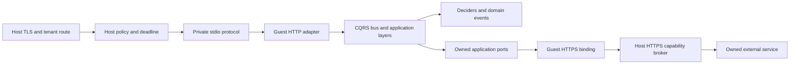

# Proposed @structure-ai/serverless package

Status: implementation-ready design proposal, not a released API. This change adds specifications only. Every TypeScript import, signature and CLI command for the future package below is **proposed** and cannot be used from the current repository. Existing package behavior is linked explicitly. No WASIX compatibility, runtime acceptance or production readiness is established by these documents.

The package lets an application keep its Effect layers, domain deciders, CQRS messages and transport-independent use cases while choosing a WASIX deployment entrypoint. The [shared contract](wasix-contract.md) owns the artifact, execution profile, capabilities, limits, wire messages and lifecycle. The [structure-infra specification](structure-infra.md) owns admission, hosting and operations. Its relative link is provisional until the companion PR lands. Shared contract changes require both implementations to update their conformance suites.

## Scope and architecture

The MVP is a bounded HTTP application, built once into a closed ESM bundle plus an approved embedded-engine WASIX runner. A warm instance serves one invocation at a time and may scale to zero. It has no general host filesystem, listener, raw network, native addon, job scheduler or durable local state. Only host-mediated public HTTPS calls cross the remote-capability boundary. A deployment is isolated by tenant, app, environment, revision, artifact, config and policy. Business tenants and user permissions remain application concerns.

The recommendation is a minimal QuickJS runner compiled to WASIX, with a small explicit Web/Effect binding layer, executed in a separately supervised native Wasmer worker. This narrows the compatibility surface and keeps JS inside guest memory. It requires implementation of the runner, event loop and bridge. Reusing the separate embedded Edge.js package may reduce porting work, but its wider Node surface requires an import/authority audit and exact version pin. Neither choice is already a verified Structure backend. The experimental Edge.js host-JS package is excluded by the [execution target](wasix-contract.md#execution-target-and-trust-boundary). Wasmtime WASI HTTP is a different target requiring a different adapter and artifact profile.



Queries remain read-only; commands name intent; business rules remain in `decide`. Domain events stay internal to a bounded context. Cross-context work remains integration events, durable outbox/inbox and idempotent consumers in the service owning the transaction. Serverless is a transport/runtime adapter, not a new domain layer or a shortcut into another context's tables. Brokered HTTP does not provide distributed transactions.

## Package surface and dependency direction

Proposed subpaths:

| Entry | Exports / purpose | Allowed dependency direction |
| --- | --- | --- |
| `@structure-ai/serverless` | `Application`, `Invocation`, `HostHttp`, tagged errors, binding/limit types | Effect, config, observability; no Bun, HTTP listener, SQL, auth or host implementation |
| `@structure-ai/serverless/http` | `fromHttpApp`, `fromHttpApi` and HTTP boundary integration | Root plus transport-neutral HTTP core and `@effect/platform`; CQRS only through existing HTTP bridge |
| `@structure-ai/serverless/wasix` | `run` and approved guest bindings | Root plus WASIX shim; only entrypoint owns execution |
| `@structure-ai/serverless/testing` | `makeHarness`, deterministic clock/entropy and capability fakes | Root; runs under Bun tests without network; cannot attest WASIX compatibility |
| `@structure-ai/serverless/build` | `build`, `inspect`, `verify` for artifacts | Host-only tooling, config and bundler/compiler ports; never imported into guest |
| `@structure-ai/serverless/cli` | `build`, `inspect`, `dev`, `verify` command definitions | Build/tooling and existing CLI package; never imported into guest |

No existing foundation package depends on serverless; no circular dependency or `http → serverless` edge is allowed. Applications compose auth and authorization just as they do today; serverless does not import them to invent a second policy system. `structure-infra` consumes the versioned contract, not guest application modules.

The proposed `@structure-ai/config/settings` subpath must export only Setting/Settings, without the current config barrel's `load.js → node:fs` import. It is a required extraction, not an optional optimization. The guest loader consumes the controlled init maps through an injected ConfigProvider; file/env loading stays host-only.

Current [HTTP serving](../../packages/http/src/serve.ts) and [runtime launch](../../packages/runtime/src/AppRuntime.ts) import `@effect/platform-bun`. Their current barrels are not guest-safe. Before implementation, expose a transport-neutral HTTP subpath containing API definitions, middleware, error mapping and CQRS bridge, and a runtime-core subpath for Readiness/Shutdown if reused. These are **proposed prerequisites**, not existing exports. Preserve existing public exports for Bun callers. Do not solve an accidental Bun import by providing dummy Bun globals or blindly tree-shaking platform initialization. Build graph inspection must show that guest code does not import platform-bun, Node builtins, process-global config loaders or native adapters.

The runtime-core extraction must preserve existing readiness and bounded drain semantics without importing `launch`. The guest adapter owns its instance Scope and protocol-triggered shutdown rather than installing OS signal handlers. No changes to existing packages or manifests are part of this specification PR. Implementation should introduce the prerequisites in separately reviewable changes, each updating its package docs and machine index when real exports exist. This PR deliberately adds no published-package entry to `llms.txt`. These choices remain proposals; acceptance of the design requires an ADR before implementing the runtime, per this directory's rules.

## Public API sketches

The proposed contract keeps instance acquisition and request dependencies explicit. It uses the existing [`Setting<A>`](../../packages/config/src/Settings.ts) shape through a **future guest-safe subpath**. The runtime supplies `HostHttp` at instance acquisition and supplies both `HostHttp` and `Invocation` per request. All other application services must be composed before these boundaries.

```ts
import type { Setting } from "@structure-ai/config/settings";
import type { Effect, Scope } from "effect";

type RequestServices = Invocation | HostHttp;
interface Handler<E> {
  readonly handle: (
    request: Request,
  ) => Effect.Effect<Response, E | RequestFailure, RequestServices>;
}
interface ApplicationInstance<E> {
  readonly handler: Handler<E>;
  readonly ready: Effect.Effect<void, E>;
}
interface ApplicationSpec<C, E> {
  readonly id: string;
  readonly settings: Setting<C>;
  readonly make: (
    config: C,
  ) => Effect.Effect<ApplicationInstance<E>, E, Scope.Scope | HostHttp>;
}
declare const Application: {
  readonly define: <C, E>(spec: ApplicationSpec<C, E>) => ApplicationDefinition<C, E>;
};
```

`ApplicationDefinition<C, E>` is opaque and retains the inferred spec. `define` validates declarations without loading config or running application effects, network or listeners. `make` acquires shared resources in the instance Scope and returns both a handler and a readiness Effect which closes over those resources. Runtime runs that readiness Effect before emitting ready. Use `ready: Effect.void` when no further local probe is needed. Revision 1 forbids remote calls during initialization: acquiring `HostHttp` is allowed, invoking fetch is not, because no Invocation exists. A remote-service preflight belongs to host admission with separate authority/timeouts; apps requiring guest network initialization are unsupported. A known unusable running instance fails affected requests and retires through drain.

`Invocation` and `HostHttp` are proposed Effect Context tags. `Invocation` carries a fresh `requestId`, `correlationId`, `remainingMs: Effect<number>`, `signal: AbortSignal` and immutable effective limits. `HostHttp` carries `fetch(grant, request)`, whose Effect requires `Invocation` and fails with `CapabilityDenied | DeadlineExceeded | DependencyUnavailable | BodyTooLarge`. Code first yields `HostHttp`, then calls the service method. Access therefore requires `HostHttp | Invocation`, exactly the handler's R channel. Cancellation remains Effect interruption, including a host `callResult` with code `Cancelled`; it is not a recoverable fetch success. Runtime owns call IDs, supplies each request Context and removes it before warm reuse. Instance services may retain the broker service but must never capture a previous Invocation.

Proposed HTTP adapter shapes:

```ts
// Future @structure-ai/serverless/http; namespaces from @effect/platform.
declare const fromHttpApp: (
  app: HttpApp.Default<
    HttpProblem,
    Scope.Scope | RequestServices | HttpRouter.HttpRouter.DefaultServices
  >,
) => Handler<never>;

declare const fromHttpApi: <E>(
  apiLayer: Layer.Layer<
    HttpApi.Api,
    E,
    RequestServices | HttpRouter.HttpRouter.DefaultServices
  >,
) => Handler<E>;
```

`HttpRouter.DefaultServices` in the installed platform is `HttpPlatform | Etag.Generator | FileSystem | Path`. The adapter **provides**, rather than requires the caller to construct, guest implementations: lexical POSIX Path; FileSystem restricted to `/artifact` read-only and `/tmp` with the contract quota, with symlink escape denied; Etag over admitted files; and HttpPlatform file responses through that restricted filesystem, buffered within bodyBytes. No OS-backed or Bun default layer is used. File APIs outside these roots fail with typed permission errors; unsupported watches/native operations fail explicitly. Static serving is not an MVP feature, even though the low-level platform interfaces must exist for HttpApi composition.

For each invocation, the adapter builds `apiLayer` in a new request Scope using the current Invocation, HostHttp and its restricted platform services. API group layers and endpoint handlers can therefore yield both tags. Shared application/domain resources are acquired in `make` and provided to `apiLayer` as values/layers; request-owned route construction is never memoized across invocations. This per-request build is a deliberate MVP cost. Readiness proves shared instance resources and adapter definition validation, not construction of request-dependent layers. A request-layer acquisition failure remains typed `E` until the runtime maps it safely to Internal; it does not retroactively become a startup failure. `fromHttpApp` supplies the same services and maps expected HttpProblems through standard HTTP middleware.

Preserve API schemas and the CQRS bridge's declared business-error 422 encoding. The installed `HttpApiBuilder.toWebHandler` is a reference, not an implementation guarantee: a future adapter must own its request runtime/context/dispose and bridge AbortSignal to Effect interruption and compound Cause semantics. No `orDie`, unsafe `_tag` cast or false `E = never` may hide resource failures. Request finalizers finish before a terminal frame; instance finalizers run only at drain.

Proposed guest entrypoint and build APIs:

```ts
// @structure-ai/serverless/wasix
declare const run: <C, E>(app: ApplicationDefinition<C, E>) => void;

// @structure-ai/serverless/build, host only
interface BuildOptions {
  readonly entry: string;
  readonly definitionFile: string;
  readonly outDirectory: string;
  readonly runnerLockFile: string;
  readonly sourceRevision: string;
}
declare const build: (
  options: BuildOptions,
) => Effect.Effect<ArtifactDescriptor, BuildError>;
```

`run` owns the process runtime, verified bootstrap/manifest, stdio and instance Scope. Domain modules never execute effects at process boundaries or fork daemon work. `ArtifactDescriptor` contains the verified digest, manifest and output path. BuildError is permanent, with bounded safe codes/file locations. Runner locks identify exact engine/source/toolchain/import inventory, never registry `latest`.

`RequestFailure` is exactly `CapabilityDenied | DeadlineExceeded | DependencyUnavailable | BodyTooLarge | AdapterInitError`. Proposed classes use `Data.TaggedError` and readonly classification. CapabilityDenied, BodyTooLarge, AdapterInitError, InvalidConfig, UnsupportedRuntime and host-local ProtocolViolation are permanent; DeadlineExceeded and DependencyUnavailable are transient. Arbitrary typed `E` and AdapterInitError map to SafeFailure Internal at the process boundary; InvalidConfig/UnsupportedRuntime during boot map to their matching startup codes. A defect maps to Internal, interruption to Cancelled with the host reason, and ProtocolViolation terminates the instance without fabricating a guest error frame. Expected application business errors must already be mapped to HTTP. No error channel carries raw causes, bodies, secret URLs or upstream messages; local typed causes are retained until the owning safe translation boundary.

## Example application and build flow

This **proposed composition sketch** uses future Settings and serverless subpaths. It has no network, listener or database. Its `ready` Effect can access resources closed over by `make`. It demonstrates API shape, not WASIX execution.

```ts
import { Settings } from "@structure-ai/config/settings";
import { Application } from "@structure-ai/serverless";
import { run } from "@structure-ai/serverless/wasix";
import { Effect } from "effect";

const app = Application.define({
  id: "greeting-api",
  settings: Settings.struct({ greeting: Settings.string("GREETING") }),
  make: (config) => Effect.succeed({
    handler: {
      handle: (request) => Effect.succeed(
        new Response(request.method === "HEAD" ? null : config.greeting, {
          status: 200,
          headers: { "content-type": "text/plain; charset=utf-8" },
        }),
      ),
    },
    ready: Effect.void,
  }),
});

run(app);
```

A network handler can yield `HostHttp` and `Invocation` in `handle`; `fromHttpApi` endpoint layers have the same requirements and receive fresh providers per request. Preserve [existing HTTP error semantics](../../packages/http/README.md#errors), with declared business [422 encoding owned by the CQRS bridge](../../packages/http/src/cqrs.ts): validation 400, authentication 401, principal permission 403, not found 404, conflict 409, business failure 422, throttling 429, deadline 504 and safe defect 500. A platform egress CapabilityDenied is an Internal-style deployment fault, mapped to gateway 502, not an application principal's 403.

### Declarative build input

The app author supplies `serverless.build.json`. This is the **single source for requested limits/capabilities and artifact key lists**. It is strict JSON with exactly `schemaVersion: 1`, `appId` and `requirements`; validation of the latter two is identical to the shared artifact schema. All 15 limit keys are mandatory, including defaults copied deliberately by the author or a future scaffold command. No inferred limits or evaluation of the entry module occurs at build time.

Proposed definition for the greeting app:

```json
{
  "schemaVersion": 1,
  "appId": "greeting-api",
  "requirements": {
    "configKeys": ["GREETING"],
    "secretKeys": [],
    "capabilities": [],
    "limits": {
      "memoryBytes": 134217728,
      "workerRssBytes": 268435456,
      "startupMs": 10000,
      "requestMs": 30000,
      "cancelGraceMs": 100,
      "drainMs": 5000,
      "idleMs": 60000,
      "bodyBytes": 1048576,
      "headerBytes": 16384,
      "headerCount": 64,
      "frameBytes": 2097152,
      "activeRequests": 1,
      "activeCalls": 4,
      "callsPerRequest": 32,
      "logBytesPerSecond": 16384
    }
  }
}
```

`build` schema-decodes this file and copies appId/requirements into the manifest. It gets runner/module/engine/toolchain/import identity from the approved runner lock, file sizes/digests from bundled bytes, and source/lock/builder provenance from explicit CI inputs. It never imports or executes `entry`, `Application.define` or `run`. `inspect` also never runs app code. Bundling parses source and resolves locked imports without running application build hooks or package scripts. Executing an arbitrary caller-provided bundler plugin is outside this API.

At actual guest initialization, the runtime compares `ApplicationSpec.id` and sorted `settings.docs` names/secret flags to the verified manifest's appId/configKeys/secretKeys before loading values; mismatch is InvalidConfig. Required/default/type validation then uses the Setting schema. Duplicate docs names or mismatched metadata fail safely. The runtime supplies no code-declared capability map: manifest requirements and host init grants are the only source. `verify` executes the bundle only in the pinned sandbox with explicit test bindings, exercises this comparison and conformance fixtures, and reports which tests ran. No secret is needed to inspect/build an artifact.

Proposed commands, **not available today**:

```sh
structure-serverless build --entry src/guest.ts --definition serverless.build.json --runner-lock runner.lock.json --out dist/serverless
structure-serverless inspect dist/serverless
structure-serverless verify dist/serverless
structure-serverless dev --artifact dist/serverless --config-file dev-config.json --secret-file dev-secrets.json
```

Build runs only on the developer/CI host. It emits a closed ESM bundle, approved runner, manifest/digest and import report. Reject unresolved/dynamic/native imports, direct eval/Function/std/os, unsupported globals and ambient module loaders. Scanning is not a security proof; admission and negative execution tests remain required. No package manager runs in the guest. `dev` uses the same artifact/protocol, explicit scoped bindings and private secret file; values never enter argv/artifact/watcher output. Simulated harness reports label themselves simulated. Production deployment and authorization belong to structure-infra.

Rebuilding the same pinned inputs must yield identical files/digest. Absolute paths, timestamps, maps and random IDs cannot perturb outputs; nondeterminism blocks the reproducibility gate. Promote those exact bytes with new environment bindings. Capability origins are a predeclared finite superset: a single build definition may enumerate both staging and production origins for a named grant; each environment's policy/init permits only its subset, and its config selects one permitted URL. These nonsecret origins are deliberate artifact topology, not an environment-specific build or environment-name code branch. Adding an unknown future origin requires a newly reviewed artifact; revision 1 provides no origin substitution beyond that superset. S01 promotion is tested within the predeclared set.

## JavaScript and package compatibility

| Surface | MVP requirement | Current evidence / unsupported cases |
| --- | --- | --- |
| ESM, Promise, typed arrays, Map/Set | Closed bundle plus embedded engine | QuickJS documents language support; full application graph remains unproved |
| Effect scheduling | Queue microtasks, bounded setTimeout/clearTimeout, monotonic clock | Shim/event-loop integration must prove yielding, interruption, timer cleanup and no starvation |
| HTTP Web APIs | Request/Response/Headers/URL, TextEncoder/Decoder, AbortController/Signal | Explicit shim work, binary/duplicate-header/abort tests required |
| Fetch / crypto / entropy | Named HostHttp service fetch; secure entropy and UUID via restricted runner binding | No ambient network fetch; no blanket WebCrypto/Intl/Node crypto claim; algorithms require explicit support |
| config | Settings schemas and controlled maps, secrets Redacted | Required future config/settings extraction and controlled-map loader; current config barrel is rejected |
| observability | Bounded untrusted stderr logs only | No guest metric/span export or OTLP bridge in revision 1; host owns metrics/traces |
| domain / CQRS | Pure Effect deciders/handlers and serializable schemas | Bus internals/dependencies still require exact graph/run tests; durable idempotency stays external |
| HTTP API schemas/middleware | Future HTTP core subpath and guest adapter | Current Bun-serving barrel is not a WASIX adapter |
| runtime | Instance Scope/readiness/drain through proposed core split | `launch` / BunRuntime / OS signal listeners excluded |
| persistence/auth/jobs/storage/mail/AI SDKs | Owned ports over explicitly supported HTTPS services | Existing Bun SQLite, Bun SQL, PostgreSQL sockets, native crypto, broker drivers and filesystem adapters are not admitted by default |
| Bun / Node / npm | Build tools may use pinned Bun on the host | No Bun globals, native addons, arbitrary `node:*`, child processes or universal npm compatibility |

Each supported tuple pins SDK, Effect/platform versions, engine/runner/toolchain, Wasmer/compiler and architecture. A pure TypeScript package is not automatically portable: its transitive imports, platform globals, filesystem/crypto needs, module initialization and event-loop assumptions must pass the build and runtime gates. Browser support and host-JS support are separate follow-ups. Upstream Node compatibility marketing does not define this package's supported surface.

## Config, state and background work

Config validation precedes application log setup and resource acquisition. Report all safe key/type issues together and fail readiness. Do not report values or arbitrary parse causes. Instance config is immutable. Local dotenv/file expansion happens only in host tooling, then feeds explicit maps. The SDK must not read its worker's shell environment or choose logic by names such as production/staging. Dynamic flags need a later explicit capability with timeout/refresh policy; they cannot mutate a running binding silently.

The filesystem and guest globals are ephemeral. Durable state belongs to an owned external service with its own tenant authorization and transactional guarantees. Host routing isolation does not filter database rows. Warm instances may retain bounded disposable connection-independent caches, with tenant/user-safe keys, expiry and no correctness dependency. Scale-down, crashes and redeploys may discard them at any point.

The MVP has no generic SQL RPC. Existing SQLite/Bun PostgreSQL adapters, event stores, snapshots, projection checkpoints, durable auth sessions and job queues stay on their supported host runtimes. An app may call its own HTTPS service that performs an entire command transaction, including expected-version checks, idempotency and event/outbox commit. Never split a transaction into unrelated HTTP statements or access another context's data through a shared bridge. Transport-independent domain logic may be reused in that service. Direct database support is a follow-up requiring connection/session/transaction/cancellation fencing and tenant enforcement, not a changed URL alone.

That external service owns connection pools and database credentials. Size its connection budget for the maximum guest instance count and egress concurrency; cap broker connections globally and per tenant, use bounded keepalive/idle lifetimes and drain them. A guest must not secretly create a fresh unbounded pool at every cold start. Cancellation after a committed transaction remains an unknown outcome requiring a durable operation key. Proxy pooling does not make a running transaction migratable between requests.

Migrations run once in an authorized deployment job or explicit operator CLI on a supported runtime with a scoped database role and lock. No guest runs migrations on startup. A deployment records the required schema generation and checks compatibility before route promotion. Use expand/backfill/switch/contract when old and new revisions coexist. Artifact rollback does not undo migrations; use an approved old-schema-compatible revision or roll forward. See existing [migration operations](../operations.md).

No durable jobs, cron, outbox relay, projection poller or arbitrary `waitUntil` runs in an idle-scale-to-zero guest. A handler may await an owned service's durable enqueue/command receipt before returning, with a durable deduplication key; that service owns retries, leases and poison handling. A 202 response requires a persisted receipt, not a forked fiber. Existing [jobs](../../packages/jobs/README.md) use PostgreSQL leases and at-least-once delivery, and existing [event sourcing](../../packages/eventsourcing/README.md) owns outbox/inbox semantics. Keep workers on supported supervised runtimes and monitor queue age/lag. Future scheduled invocations need a versioned dispatch/ack/lease ABI and cannot be added as an undocumented HTTP header.

## Bigatelier migration example

This is a **proposed migration pattern**, not an audit of Bigatelier's current repository or a claim that it already matches this architecture. The bounded first slice is an authenticated catalog query and an intent command that returns a durable operation receipt. No client data or credentials are needed for the proof fixture.

1. Inventory the slice's dependency graph and current response/error schemas. Identify Bun.serve/runtime imports, database/native libraries, file access, auth/session crypto, streaming endpoints, recurring jobs and outbox/projection loops. Keep unsupported routes on the current runtime. Establish the current command and read-model behavior with existing feature fixtures.
2. Keep deciders, command/query payloads and business errors in transport-independent modules. Keep the service owning durable data, authentication/session verification and command transactions on the current supported runtime. Expose a narrow HTTPS API authorized for the deployment service identity and the actual end-user action. The guest must forward end-user identity through a verified delegation scheme; deployment identity alone cannot authorize every user.
3. Add a guest entrypoint for the catalog slice using future `fromHttpApi`; provide an application port by yielding HostHttp in a request-owned handler/layer and invoking its fetch service with grant `catalog`. Its manifest declares only the catalog origin and required config/secret keys. The server constructs the URL from validated config plus safe encoded identifiers, never from an unrestricted caller URL. Verify principal/tenant authorization on the owning service as well as the guest.
4. Commands carry a durable idempotency key to that service and commit domain state plus integration outbox atomically there. Return the committed operation ID, or 202 only for a persisted receipt. A lost guest response may be reconciled by querying that ID/key. The existing worker continues job dispatch, projections and outbox delivery through scale-to-zero events.
5. Run migrations through the existing deployment policy, build one immutable artifact, create a scoped staging binding and pass the contract tests. Test missing identity, wrong tenant, duplicate command, crash after commit, secret rotation and read-model lag. Compare wire responses with the existing API, including business 422 and conflicts.
6. Route a limited catalog slice only after readiness and compatibility gates. Observe cold/warm latency, errors and downstream connections, then expand gradually. Roll back the route to the prior compatible runtime/binding on failure; do not rebuild or reverse a database migration automatically.

For this first slice, the WASIX guest is an application adapter and may delegate the transactional use case. It does not demonstrate direct event-sourced persistence from WASIX. A later slice can move more use-case execution only when every required persistence/auth/provider port has a supported implementation and proof. Reusing domain code is safe only when its complete dependency graph satisfies the profile.

## Lifecycle, error and telemetry integration

Follow the [normative lifecycle](wasix-contract.md#lifecycle-cancellation-and-http-outcomes): boot/hello/init, typed settings, bounded log setup, shared resource acquisition, local required probes, then ready. Request-dependent HttpApi layers build within each request, with their own typed failure path. One request Scope owns its fibers, timers, calls and finalizers. Terminal frames are emitted only after request cleanup. Drain flips unready, stops dispatch, finishes within the smaller request/drain budget, closes instance layers, flushes bounded telemetry and exits. Forced kill is an expected failure mode, not a successful graceful shutdown. A durable side effect must survive both paths correctly.

SDK interruption is cooperative inside the guest; the host's independent timer/process boundary enforces hard limits even during busy loops. Fetch abort closes host work and rejects the guest Effect, but cannot undo a remote commit. Neither host nor SDK retries a dispatched request. Application client retries are bounded, use the same durable key when appropriate and fit within the remaining deadline. No nested implicit retries may multiply load.

The host owns ingress/queue/startup/dispatch/egress/termination metrics and traces. Revision 1 guest telemetry is only bounded untrusted stderr, never a protocol frame. The SDK may write sanitized log text with the authoritative Invocation correlation ID and matched route template; the host wraps it in instance/request metadata but does not parse it as trusted metrics, spans or audit events. No guest OTLP exporter or joined distributed trace is provided. Arbitrary tenant code can deliberately leak its own secret to its tenant log sink; platform redaction cannot make that safe. Host credentials and other tenants' data must never be accessible to it.

Do not emit raw paths/queries, bodies, Authorization/Cookie, secret/config values or prompts from SDK logging. Host metrics use bounded route/operation/failure labels, never request/user/tenant IDs. Approved tenant context may enter access-controlled logs under retention policy. Host audit events separately record deployment/grant/secret/routing changes. Host spans cannot join guest spans without a later protocol extension; correlation IDs join host records and guest logs. Native OTLP exports stay in host components.

Required host signals include cold-start duration/failure, active/queued/rejected requests, capacity, outcomes/latency, guest/worker memory, hard kills, egress denials and dropped stderr/host-export records. External workers monitor their queue/projection lag. Host exporter outage must remain bounded and observable; S08 exercises host collection failure or stderr backpressure, not a nonexistent guest exporter. Define user-facing objectives from measured cold/warm behavior before production rollout. No latency/cost benefit is promised.

## SDK assumptions and blocking spikes

All rows are future work. A failed or unexecuted row blocks the named implementation phase; no upstream language feature claim substitutes for the experiment.

| ID | Assumption to settle | Experiment and exit evidence |
| --- | --- | --- |
| K1 | QuickJS/WASIX can run the closed Effect graph and scheduler | Pin tuple; run Promise/microtask/timer/yield/encoding/Schema fixtures in actual guest; inventory every import/global; block phase 1 on unsupported graph |
| K2 | Guest-safe config/HTTP/runtime/observability extractions preserve Bun APIs and deny ambient authority | Typecheck both entrypoints; inspect transitive imports; negative node:fs/Bun/std/os cases; restricted platform FileSystem/Path/HttpPlatform tests before phase 2 |
| K3 | Entry bundling is closed and deterministic without evaluation | Build twice from fixed definition/runner/source/lock inputs; exact byte/digest equality; sentinel top-level side effects must not execute during build/inspect; mismatched settings metadata fails actual guest init |
| K4 | AbortSignal and Effect scopes preserve interruption and typed/compound causes | Request-dependent HttpApi layer fixtures yield Invocation/HostHttp; cancel during acquisition/handler/finalizer; inspect no leaked request services/calls; busy loop/microtasks killed by supervisor |
| K5 | Resource/platform/stdio bindings fit the fixed budgets | Binary/header/ETag/file responses, forbidden roots, frame corruption, heap/linear/native memory, timers and stack tests; bounded failure with sibling tenant responsiveness |
| K6 | Cold/warm cost and observability are operationally acceptable | Measured startup/per-request distributions, memory/CPU and downstream connection use; finite log/host-export outage; operator-approved objectives before phase 4 |

## Delivery phases and acceptance

All runtime rows below are **unexecuted future acceptance requirements**. Documentation lint/typecheck/tests prove repository health only; they do not run a WASIX guest. The [contract matrix C01–C15](wasix-contract.md#compatibility-and-promotion-gates) is mandatory in addition to these SDK rows.

| Phase | Deliverable / bounded exit gate |
| --- | --- |
| 0, compatibility spike | Pin runner/QuickJS/toolchain/Wasmer tuples; produce guest import inventory, closed Effect bundle, shim tests, hard-kill/memory/stack evidence and cold/warm measurements. Unsupported or unsafe profile blocks phase 1 |
| 1, neutral composition | Introduce guest-safe HTTP/runtime/config/observability surfaces with preserved Bun APIs; independent dependency graph and behavior tests. No published serverless support before exports and docs exist |
| 2, package and local runner | Implement typed root/subpaths, immutable artifact builder/verifier, stdio runtime and deterministic harness. Pass SDK rows S01–S08 and contract C01–C15 locally for the supported tuple |
| 3, host conformance | structure-infra implements contract admission, policy, supervised isolation, routing, drain and scale-to-zero; pass the same fixtures in deployed isolated test hosts, cross-version denial and multi-tenant abuse tests |
| 4, first application slice | Bigatelier-shaped fixture plus an explicitly approved real slice, migration/rollback plan, current-head CI, operational owner/objectives/runbooks and independent security review. Controlled promotion is a later authorization |
| Follow-ups | Streaming/SSE/WebSockets, scheduled/leased invocations, direct durable database adapters, private service grants, richer crypto/Node APIs, alternate engines and WASI HTTP components each need explicit compatibility and protocol decisions |

| ID | Scenario | Observable acceptance |
| --- | --- | --- |
| S01 | Build the same locked greeting app twice without evaluating entry; change only deployment config within declared origin superset | Identical artifact bytes/digest; changed runtime greeting with new configRevision; no secret/env embedded |
| S02 | Build app importing Bun, node:fs, native addon, std/os, dynamic loader or unapproved module | Explicit safe build error/import report, no deployable artifact |
| S03 | Build definition/settings metadata mismatch; missing, unknown or invalid settings plus secret parse failure | All safe issues reported before make/ready; no value disclosure; startup fails |
| S04 | Existing HttpApi/CQRS fixture under Bun transport and guest adapter | Same schema/status/business 422/compound Cause semantics; separate WASIX run recorded |
| S05 | HttpApi endpoint layer/handler yields Invocation/HostHttp; a different authenticated user invokes warm instance | Fresh request scope, no prior principal/transaction/call, calls attributed and authorized correctly |
| S06 | Handler forks work, times out, disconnects, defects or returns a too-large streaming body | Request scopes closed/joined before terminal; safe mapping and bounded kill where uncooperative |
| S07 | External command commits but response is lost; retry uses durable key; scale guest to zero | One durable business result, reconciled status, outbox/worker progresses independently |
| S08 | Force shared startup/readiness and request-layer/finalizer failure; block stderr or host collector/exporter | No premature readiness, bounded failure/drain, no recursive logging, dropped signals observable |

The pure testing harness must allow deterministic host config/secret maps, fake capability responses, deadlines and cancellation, capture structured terminal outcomes and assert no leaked fibers/calls. It must not perform network, use real providers or pretend to enforce native process isolation. Runner integration tests execute the same artifact/frame fixtures in actual WASIX; security tests exercise denied syscalls, malformed frames, SSRF and hostile CPU/memory/Promise loops with an independent supervisor. Real external-service scenarios run only in explicit isolated integration infrastructure, separate from the default network-free suite.

An implementation PR must publish exact tuple/digest, commands and exits, tests actually executed, skips, source/import inventory, resource measurements and remaining unsupported APIs. Promotion requires all mandatory SDK/contract/host gates, independent review and operational ownership. A failed or unexecuted gate remains blocked; changing an engine/profile requires a new recorded compatibility decision, not a broader claim.
