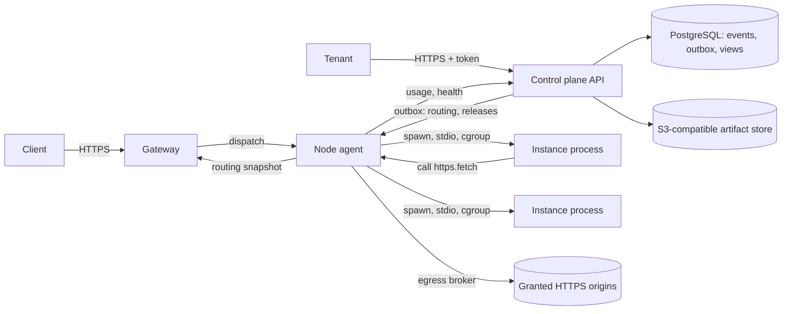

# structure-infra: hosting Structure WASIX applications

Status: proposed specification, 2026-10-20. Nothing in this document is implemented. Every API, CLI command, schema, file name and default below is a proposal until an implementation and its tests exist.

structure-infra is a future, separately deployed project. It accepts Structure applications built for WASIX with `@structure-ai/serverless`, runs them as isolated, scale-to-zero instances behind an HTTP gateway, and manages tenants, artifacts, configuration, secrets and releases. This document specifies the host. It does not create the project's repository or code.

Two sibling specifications own the rest of the system:

| Document | Owns |
| --- | --- |
| [wasix-contract.md](wasix-contract.md) | The normative guest/host contract: artifact layout and digest, `abi`, `protocol`, `executionProfile`, every protocol message and field, the boot and drain lifecycle, limit ceilings, the `https.fetch` call, and the deployment envelope. |
| [serverless.md](serverless.md) | The `@structure-ai/serverless` guest package: how an Effect/CQRS application becomes a WASIX artifact and what it can call. |

When this document names a contract field or message, the contract's definition wins. This document adds host behaviour only: who enforces what, with which mechanism, and what happens when it fails. The links above are provisional until both documents land.

## Contents

1. [Scope and MVP boundary](#scope-and-mvp-boundary)
2. [Terms](#terms)
3. [Verified upstream facts, recommendations and assumptions](#verified-upstream-facts-recommendations-and-assumptions)
4. [Runtime and process choice](#runtime-and-process-choice)
5. [Architecture](#architecture)
6. [Control plane](#control-plane)
7. [Tenant authentication and authorization](#tenant-authentication-and-authorization)
8. [Artifact admission](#artifact-admission)
9. [Configuration, policy and secrets](#configuration-policy-and-secrets)
10. [Releases, activation and rollback](#releases-activation-and-rollback)
11. [Request path](#request-path)
12. [Concurrency, scale to zero and draining](#concurrency-scale-to-zero-and-draining)
13. [Resource and capability enforcement](#resource-and-capability-enforcement)
14. [Egress broker for https.fetch](#egress-broker-for-httpsfetch)
15. [Durable state, databases and migrations](#durable-state-databases-and-migrations)
16. [Background jobs, outbox and projections](#background-jobs-outbox-and-projections)
17. [Observability](#observability)
18. [Failure handling and recovery](#failure-handling-and-recovery)
19. [Security model](#security-model)
20. [Proposed public API sketches](#proposed-public-api-sketches)
21. [Examples](#examples)
22. [Implementation phases](#implementation-phases)
23. [Spikes](#spikes)
24. [Acceptance scenarios](#acceptance-scenarios)
25. [Tests and compatibility gates](#tests-and-compatibility-gates)
26. [Contract alignment](#contract-alignment)
27. [Sources](#sources)

## Scope and MVP boundary

The MVP hosts HTTP applications whose artifacts satisfy `abi: structure:wasix/1`, `protocol: structure:stdio/1` and `executionProfile: quickjs-wasix-stdio/1` from the contract. It runs on one Linux host. Every instance is a separate operating-system process that embeds a pinned Wasmer release and talks to the host only through stdin, stdout and stderr.

In the MVP:

- An operator registers tenants. Tenants authenticate to a control-plane HTTP API with scoped tokens.
- A tenant creates applications and environments, uploads immutable artifacts, sets configuration and write-only secrets, creates releases and activates or rolls them back atomically.
- The gateway terminates TLS, routes by hostname to the environment's active release, buffers the request, and dispatches it to a warm or newly started instance. One instance serves one request at a time.
- Instances scale from zero on demand, are reused while warm, and stop after the idle timeout.
- The host enforces memory, CPU, process count, wall-clock, frame, body, header, queue and instance-count limits. It mediates every outbound call. The guest has no network, no host filesystem beyond its own read-only artifact files, and no access to other tenants.
- The host's own state lives in PostgreSQL through Structure's event-sourcing packages. Artifacts live in S3-compatible storage through `@structure-ai/storage`.

Not in the MVP, and refused with a specific error where a request could express them:

| Unsupported | Behaviour | Earliest phase |
| --- | --- | --- |
| Raw TCP/UDP sockets, DNS, guest listeners, database drivers inside the guest | No such capability exists in `structure:wasix/1`. Admission accepts only an approved runner's exact imports, and the runtime denies socket and DNS calls even when the runner imports them. | Later contract version, see [durable state](#durable-state-databases-and-migrations) |
| A tenant database provisioned or pooled by the host | Not offered. Applications keep state behind HTTPS services they own and reach through `https.fetch`. | Phase 5, gated on the contract |
| Background jobs, schedules, outbox relays or projection workers inside the guest | Not offered. The guest has no work outside a request. | Phase 5, gated on the contract |
| Streaming delivery: server-sent events, WebSocket, HTTP upgrades, trailers, incremental responses | Upgrades, `CONNECT` and trailers get `501 unsupported_protocol` before dispatch. A finite chunked request body is not streaming: the gateway buffers it within `bodyBytes` and the deadline. A guest that returns a finite stream has it collected by the guest package before `response`, so the host only ever sees a complete body. | Later contract revision |
| Bodies over the contract's 1 MiB decoded limit | `413` before dispatch for requests, `502` for guest responses. | Contract change only |
| Threads, `fork`, subprocesses, native addons, Node `napi` host imports | Denied. A `napi` import fails admission. Thread and process calls fail at runtime. | Later profile |
| Edge.js host-JavaScript mode (`syrusakbary/edgejs`) | Not a host profile. Upstream records it as experimental and not a security boundary. | Only after upstream's own exit criteria |
| Wasmtime `wasi:http` components | A different ABI. Not accepted by this profile. | Separate future profile |
| General Node.js or Bun compatibility | Not claimed. Only the bindings the contract defines exist. | Not planned |
| Custom domains, automatic certificates | Hostnames come from the operator's wildcard domain. | Phase 4 |
| Multiple nodes, zones or regions | One node. The control-plane model already carries node identity. | Phase 4 |
| Traffic splitting, canaries, minimum warm instances, memory snapshots | Not offered. | Phase 4 or later |

## Terms

These words have one meaning in this document, in the future code and in its API.

| Term | Meaning |
| --- | --- |
| Operator | The person or team running a structure-infra installation. |
| Tenant | An isolated customer account. Every other resource belongs to exactly one tenant. |
| Application | A named deployable unit inside a tenant. |
| Environment | A named target of an application (`production`, `preview-42`). It owns one hostname and at most one active release. Its name never changes host behaviour. |
| Revision | One admitted, immutable artifact of an application, identified by `revisionId` and `artifactDigest`. |
| Configuration revision | An immutable set of non-secret values and secret references for one environment, identified by `configRevision`. |
| Policy revision | An immutable set of grants and limits the operator or tenant admin allows for one environment, identified by `policyRevision`. |
| Release | The activation unit: one revision bound to one configuration revision and one policy revision, after the host has proved that it boots. |
| Activation | The environment's pointer to its serving release, with a monotonically increasing `generation`. |
| Binding key | `(tenantId, appId, environmentId, revisionId, artifactDigest, configRevision, policyRevision)`. Warm instances are reused only for an identical key. |
| Node | One Linux host running the gateway and the node agent. |
| Gateway | The public HTTP entry point on a node. |
| Node agent | The node-local supervisor. It starts, feeds, limits and stops instances, and runs the egress broker. |
| Instance | One operating-system process running one guest for one binding key. |
| Invocation | One `request` message delivered to an instance, from dispatch until its terminal message or the instance's death. |

## Verified upstream facts, recommendations and assumptions

This section separates three kinds of statement. Verified facts were read in primary sources on 2026-10-20 and are listed with their source in [Sources](#sources). Recommendations are this specification's design. Assumptions need a [spike](#spikes) before implementation depends on them.

### Verified upstream facts

| Fact | Source |
| --- | --- |
| WASIX extends WASI preview 1 with POSIX-style process, thread and socket calls. It is a core-module ABI, not the component model. | wasix.org, `wasix-org/wasix-witx` |
| Wasmer's latest release is v7.5.0 (2026-10-01). v7.4.2 was released 2026-09-16. | GitHub releases, `wasmerio/wasmer` |
| Wasmer v7.5.0's `lib/wasix/src/runners/` contains only the WASI runner (`mod.rs`, `runner.rs`, `wasi.rs`, `wasi_common.rs`). There is no built-in HTTP or CGI runner. Under the stock runner, a WASIX program serves HTTP directly only through its own sockets. A custom embedder can bridge HTTP another way, which is what the contract's stdio protocol does. | `wasmerio/wasmer` tree at `v7.5.0` |
| `wasmer_wasix::Capabilities` has `threading.max_threads` (default `None`, meaning unlimited), `polling.max_poll_subscriptions` (default 1024), `max_sock_recv_size` (default 16 MiB) and `insecure_allow_all`. | `lib/wasix/src/capabilities.rs` at `v7.5.0` |
| The WASIX `Runtime` trait lets an embedder supply the networking implementation, the task manager, the engine, `new_store`, extra imports and an `on_taint` hook. | `lib/wasix/src/runtime/mod.rs` at `v7.5.0` |
| `virtual_net` ships `UnsupportedVirtualNetworking`, `LoopbackNetworking` and `LocalNetworking::with_ruleset`. The ruleset language allows or denies `dns`, `ipv4` and `ipv6` rules, and expands a DNS rule to an outbound IP rule. | `lib/virtual-net/src/{loopback,ruleset}.rs`, `lib/cli/src/commands/run/wasi.rs` at `v7.5.0` |
| The Wasmer CLI's `run` command has no flag for a memory, CPU or wall-clock limit. Linear-memory caps are shown through a custom `Tunables` implementation (`examples/tunables_limit_memory.rs`). Wasmer ships a metering middleware (`lib/middlewares/src/metering.rs`). | `wasmerio/wasmer` at `v7.5.0` |
| `wasmer::Module::deserialize` and its variants are `unsafe fn`. In v7.5.0 the checked wrapper also delegates to the unchecked backend. A serialized module must come from a trusted producer, and no flag makes untrusted compiled bytes safe. | `lib/api/src/entities/module/mod.rs` at `v7.5.0` |
| Edge.js publishes two WASIX packages. `syrusakbary/edgejs` (0.1.24 in the root `wasmer.toml`) imports `napi` and `napi_extension_wasmer_v0` and embeds no JavaScript engine. `wasmer/edgejs-quickjs` embeds QuickJS. Edge.js publishes no GitHub releases. Its only git tag is `rust-v0.0.1`. | `wasmerio/edgejs` README and manifests |
| Upstream states that the host-JavaScript mode is experimental and must not be treated as a security boundary until a threat model, realm-escape tests and an external review exist. It lists resource controls (CPU interruption, memory, microtask starvation) as separate work. | `wasmerio/edgejs` `SECURITY-HOST-JS-NAPI.md` |
| Open issue wasmerio/edgejs#161 (2026-09-29): in `wasmer/edgejs-quickjs` 0.1.4 and 0.2.4 under Wasmer CLI 7.4.2, `process.exit()` does not stop the current synchronous JavaScript. | GitHub issue |
| WASI 0.3.0 was released on 2026-06-11. Wasmtime 46 is the first release to implement it. In WASI 0.3, `wasi:http/service` replaces WASI 0.2's `wasi:http/proxy` world, and current `wasmtime serve` supports both. These are component-model worlds, not WASIX core modules. | wasi.dev, docs.wasmtime.dev |

### Recommendations (this design, not upstream behaviour)

- Run every instance in its own process, embedding Wasmer through `wasmer-wasix`, with no networking implementation, inside an OS sandbox that enforces memory, CPU and process limits independently of Wasmer.
- Keep the control plane in TypeScript on Structure's own packages, and the node agent, gateway and runner in Rust.
- Pin one Wasmer version and one verified `runner.wasm` per execution profile. Upgrades go through the compatibility gate.

### Assumptions that need a spike

Each assumption names the spike that settles it. Implementation of the dependent phase does not start until the spike's exit evidence exists.

| Assumption | Spike |
| --- | --- |
| A custom `Tunables` returned through `Runtime::new_store`/`engine` caps the guest's linear memory during WASIX instantiation, and `memory.grow` past the cap fails inside the guest instead of aborting the host process. | S2 |
| `UnsupportedVirtualNetworking` plus `Capabilities` with threads denied gives the quickjs-wasix-stdio runner every call it needs and no socket call succeeds. | S1 |
| The chosen OS sandbox launcher allows Wasmer's code generation (executable memory mappings) while denying everything else the runner does not need. | S3 |
| The runner answers `cancel` within the contract's 100 ms grace under ordinary load, and the supervisor's kill path is reliable when it does not. | S5 |
| Cold-start and per-request overheads fit the contract's 10 s startup and 30 s request ceilings on the reference node. No number is claimed until S8 measures it. | S8 |
| The node's suspend-aware clock, the wall-time pause check and the renewal barrier keep every node within the published revocation deadline, with clock drift inside the 1 s margin. | S9 |

## Runtime and process choice

### Options considered

| Option | Isolation | Fit with the contract | Decision |
| --- | --- | --- | --- |
| A. Many guests inside one long-lived host process (one Wasmer store per guest) | Wasm sandbox only. A runtime defect or host-memory leak in one guest affects every tenant in the process. Memory accounting covers linear memory, not host allocations made on the guest's behalf. | Possible, but cancellation by killing is unavailable without killing everyone. | Rejected for MVP. |
| B. One `wasmer run` CLI process per instance | Process isolation. | The CLI cannot cap memory, CPU or wall-clock time (verified). It offers no hook for a frame-level supervisor beyond its stdio. | Rejected: limits would rest entirely on the OS layer, and the CLI is not a stable embedding interface. |
| C. One custom runner process per instance, embedding `wasmer-wasix`, inside an OS sandbox | Two independent layers: the Wasm sandbox with explicit `Capabilities`, networking and `Tunables`, and an OS sandbox with cgroup limits, namespaces and a syscall filter. | Matches the contract's "dedicated supervised OS process", stdio protocol, one request at a time and kill-on-grace-expiry. | Recommended. |
| D. Wasmtime with `wasi:http` components | Strong, well-documented resource controls. | Different ABI. Cannot run WASIX core modules. | Not this profile. A future profile with its own contract. |
| E. Edge.js host-JavaScript mode | Upstream says it is not a boundary yet. | Needs `napi` imports the contract forbids. | Rejected. |
| F. One container or microVM per instance | Strongest isolation. | Works, but the Wasm sandbox becomes redundant, and image and boot overhead cut against scale to zero. | Kept as a later hardening option behind the same node-agent interface. |

### Recommended design

The node agent starts each instance as a child process, `structure-infra-runner`, with:

- a fresh cgroup v2 leaf under the agent's delegated subtree, with `memory.max` set to the effective `workerRssBytes` (contract ceiling 256 MiB), `memory.swap.max` at 0, `pids.max` sized for the runner's own runtime threads (set by S1, not by the guest) and `cpu.max` at most one CPU, as the contract requires;
- new user, mount, PID, IPC, UTS and network namespaces. The network namespace has no interfaces except a down loopback. The guest needs no network because `https.fetch` travels over stdio to the egress broker;
- a read-only bind mount of the revision's verified files at the contract's `/artifact` path and of the node-compiled module, a private `/tmp` capped at the contract's 8 MiB and cleared at exit (a size-limited tmpfs in the instance's mount namespace, or an in-memory Wasmer mount, chosen in S1), and nothing else from the host filesystem;
- `no_new_privs`, all capabilities dropped and a syscall allowlist from S3;
- an environment containing only what the runner needs to find its files. Configuration and secrets arrive in the contract's `init` message, never in the process environment or the command line.

Inside the process the runner:

- loads the compiled module that the node itself produced (never one that came from an upload, because Wasmer deserialization is `unsafe`);
- builds a `wasmer_wasix` runtime with `UnsupportedVirtualNetworking`, `Capabilities::new()` with guest threads denied (the contract allows one worker thread) as S1 determines, no forwarded host environment, no mapped directories other than `/artifact` and `/tmp`, no injected packages and no mapped host commands;
- installs a memory-limiting `Tunables` at the effective `memoryBytes` (contract ceiling 128 MiB), and runs the guest with the contract's 4 MiB native stack budget;
- connects the guest's stdin and stdout to the agent's pipes and its stderr to the agent's log collector.

The node agent, the gateway and the runner are Rust, because Wasmer's embedding API is a Rust library and the hot path needs direct control of pipes, cgroups and signals. The control plane is TypeScript on Structure, because it is an ordinary CQRS application. No performance claim follows from either choice. S8 measures the result.

### Version pinning

The contract's admission tuple is `(schemaVersion, abi, protocol, executionProfile, engineVersion, runnerBuild, toolchain, actual imports)` plus the host's engine, compiler and platform. The host stores each approved tuple as a row of its compatibility matrix:

```text
schemaVersion           1
abi                     structure:wasix/1
protocol                structure:stdio/1
executionProfile        quickjs-wasix-stdio/1
runtime.engine          quickjs
runtime.engineVersion   <exact QuickJS version from the guest toolchain>
runtime.runnerBuild     <64-hex runner build identity>
runtime.toolchain       wasix-toolchain@sha256:<digest>
runner.wasm sha256      <digest of the verified runner bytes>
runner imports          <exact import list taken from that module>
host engine             wasmer 7.5.0 (exact crate versions locked)
host compiler           cranelift (S1 confirms)
host platform           linux x86_64 | linux aarch64
```

`runtime.engine` names the JavaScript engine inside the guest. The host engine is Wasmer. Admission accepts an artifact only when its tuple matches a row exactly. There are no version ranges. Adding or changing a row runs the full [compatibility gate](#tests-and-compatibility-gates) and invalidates the node's compiled-module cache entries for that row.

## Architecture



The control plane decides. The data plane (gateway and node agent) applies decisions and serves traffic. The data plane never writes control-plane tables. It reports facts back through the node API, and the control plane turns them into commands.

| Component | Responsibilities | Durable state |
| --- | --- | --- |
| Control plane | Tenants, tokens, applications, environments, admission, configuration, policy, secrets, releases, activation, quotas, audit, node registry. | PostgreSQL via `@structure-ai/eventsourcing-pg` and `@structure-ai/viewmodel`. Artifacts via `@structure-ai/storage`. |
| Gateway | TLS, hostname routing from the node's current authority snapshot, header sanitising, rate limits, request buffering, deadlines, host-originated errors. | None. |
| Node agent | Instance pools per binding key under environment-wide caps, the authority lease, process lifecycle, stdio protocol, limits, cancellation, draining, egress broker, compiled-module cache, log collection, usage reports. | Compiled-module cache on local disk, rebuildable. The authority snapshot is held in memory only, and a restarted node fetches a fresh one before it serves. |
| Instance | One guest, one binding key, one invocation at a time. | None. |

## Control plane

The control plane is a Structure application. Business rules live in deciders, handlers coordinate, queries read view models, and cross-component effects leave through the outbox. It follows [architecture.md](../architecture.md) and [operations.md](../operations.md) without exceptions.

### Bounded contexts

| Context | Aggregates | Owns |
| --- | --- | --- |
| Tenancy | `Tenant`, `ApiToken` | Tenant lifecycle, quotas, tokens and their scopes. |
| Catalogue | `Application`, `Revision` | Applications, artifact upload, admission results. |
| Delivery | `Environment` | Configuration revisions, policy revisions, secret-version revocations, releases with their verification and quarantine state, and the activation pointer. |
| Secrets | `SecretSet` (one per environment) | Encrypted secret values and their erasure. |
| Fleet | `Node` | Node registration, compatibility matrix, authority snapshots, applied positions, usage reports. |

Contexts refer to each other by id. Delivery reads a revision's admission outcome from the Catalogue's integration event, not from its tables.

Every fact that decides whether a release may be activated or keep serving lives in one `Environment` stream: the release's verified or quarantined state, its bound secret versions, its effective grants and limits, the current policy and the revoked secret versions. An activation is decided on that state and appended with the stream's optimistic version check, so a concurrent quarantine, revocation or policy change either lands before it, and the activation sees it, or after it, and the activation was valid when it was recorded. No view or other stream is read to make the decision. Secret values stay in the Secrets context. Revocation is decided in the `Environment` stream first, and Secrets erases the ciphertext afterwards from the outbox.

Two facts live outside that stream: tenant suspension (Tenancy) and the retirement of a matrix row (Fleet). Neither is part of the activation decision. Both are enforced where requests are served: the [authority snapshot](#node-authority-lease) lists suspended tenants and approved matrix rows, and a node never dispatches to a suspended tenant or starts an instance on a retired row. An activation that races either change records a pointer that no node serves, and Delivery quarantines the affected releases when it consumes the integration event.

### Aggregates and invariants

| Aggregate | Invariants enforced in `decide` |
| --- | --- |
| `Tenant` | A suspended tenant accepts no uploads, releases or activations. Quotas never go below current usage at the moment of change (the change is rejected instead). |
| `ApiToken` | Scopes are a subset of the issuer's scopes. A revoked or expired token never becomes valid again. |
| `Revision` | States move `uploaded → admitted` or `uploaded → rejected`, once. An admitted revision's `artifactDigest` never changes. |
| `Environment` | Releases move `created → verifying → verified`, `verifying → failed`, `verified → quarantined`, and a release's binding key never changes. At most one active release. Activation requires a release of this environment that is verified, not quarantined, bound to no revoked secret version, and whose every effective grant origin and limit fits the current policy. Every activation and deactivation increments `generation` and carries the caller's `expectedGeneration`. A revoked secret version is never un-revoked. The stream keeps the 100 most recent releases. Older ones are archived and cannot be activated. |
| `SecretSet` | Values are write-only. Erasure follows a revocation recorded in Delivery and is never undone. |
| `Node` | A node's applied snapshot position never decreases. |

### Commands and events

Commands are intent-named and dispatched through `@structure-ai/cqrs`, with idempotency keys on every mutating API call.

| Command | Aggregate | Accepted event(s) |
| --- | --- | --- |
| `RegisterTenant`, `SuspendTenant`, `ResumeTenant` (operator) | `Tenant` | `TenantRegistered`, `TenantSuspended`, `TenantResumed` |
| `IssueApiToken`, `RevokeApiToken` | `ApiToken` | `ApiTokenIssued`, `ApiTokenRevoked` |
| `CreateApplication` | `Application` | `ApplicationCreated` |
| `BeginRevisionUpload`, `CompleteRevisionUpload`, then `RecordAdmission` (admission worker) | `Revision` | `RevisionUploadStarted`, `RevisionUploaded`, then `RevisionAdmitted` or `RevisionRejected` |
| `CreateEnvironment` | `Environment` | `EnvironmentCreated` |
| `SetEnvironmentConfig` | `Environment` | `ConfigRevisionRecorded` |
| `SetEnvironmentPolicy` (tenant admin within operator limits) | `Environment` | `PolicyRevisionRecorded` |
| `PutSecret` | `SecretSet` | `SecretVersionCreated` |
| `RevokeSecretVersion` | `Environment` | `SecretVersionRevoked`, then Secrets erases the ciphertext (`SecretVersionErased`) |
| `CreateRelease`, then `RecordVerification` (verifier) | `Environment` | `ReleaseCreated`, then `ReleaseVerified` or `ReleaseVerificationFailed` |
| `ActivateRelease`, `DeactivateEnvironment` | `Environment` | `ReleaseActivated`, `EnvironmentDeactivated` |
| `QuarantineRelease` (system or operator) | `Environment` | `ReleaseQuarantined` |
| `ReportNodeState` (node) | `Node` | `NodeSnapshotApplied`, `UsageRecorded` |

Events carry ids, digests, revisions, actors and reasons. They never carry secret values, configuration values marked sensitive, request bodies or tokens. Because the stores are event-sourced, these events are the audit trail.

### Read models

| View | Serves |
| --- | --- |
| `authority_snapshot` | Per node: the routing entry of every environment (hostname, generation, active binding key, effective limits and grants), the current policy, revoked secret versions, quarantined releases, suspended tenants and approved matrix rows, stamped with the event-store position it reflects. |
| `releases_by_environment` | Release list, states and failure reasons for the API. |
| `revisions_by_application` | Revision list and admission outcomes. |
| `tenant_usage` | Instance-seconds, requests, egress bytes per tenant and minute, for quotas and reporting. |
| `node_status` | Applied snapshot position, lease state and health per node. |

### Revocations and the revocation ledger

A revocation is any decision that removes authority: a policy revision that narrows a grant, `SecretVersionRevoked`, `ReleaseQuarantined`, `TenantSuspended`, `ApiTokenRevoked` and the retirement of a matrix row. Lowering a limit is not a revocation. It follows the non-urgent [policy rebind](#policy-revisions).

Every revocation is written first to a revocation ledger, then to its aggregate's stream. The ledger is an append-only object-storage prefix with a retention lock that the operator configures. Each entry is identified by a `revocationId`. For a command dispatched with an idempotency key, it is the SHA-256 of the command's full idempotency identity as `@structure-ai/cqrs` scopes it: tenant, actor, command tag, idempotency key and the payload hash. For a command without a key, it is a random UUIDv4. Two actors using the same key string, or one actor sending a different payload, therefore get different ids. An exact replay gets the same id. The bus already rejects one actor's reuse of a key with a different payload as `IdempotencyMismatch` before any ledger write. The entry records the `revocationId`, tenant, actor, command tag, key, payload hash, target and the event to append. The event carries the same `revocationId`. Writing an entry whose `revocationId` already exists is a no-op, and nothing is ever deduplicated by key or target alone. The command handler:

1. writes the ledger entry and waits until the object store confirms it is durable;
2. appends the event to the aggregate's stream with the usual version check;
3. acknowledges the command with the stream position and the completion deadline.

The handler validates the command before step 1. After step 1 the event must be appended: a revocation has no business check left that could fail, so a version conflict only makes the handler read the stream again and retry. A crash after step 1 leaves an entry with no event. A reconciler in the control plane, run at startup and every `leaseRenewMs`, appends the event for every ledger entry whose `revocationId` no event in the store carries, and the stream append is deduplicated by that `revocationId` only. A crash before step 1 leaves nothing, and the client retries with the same key. A revocation that a client saw acknowledged is therefore always in the ledger. If the ledger cannot be written, the command fails with `503` and nothing changes. The control plane refuses to renew leases while it cannot read the ledger, or while the reconciler knows of a ledger entry older than `leaseRenewMs` whose event is not yet appended. So a revocation that is durable in the ledger cannot be left out of a renewal for longer than that.

Restoring a database backup works the same way. Before serving any snapshot, the restored control plane replays every ledger entry its event store lacks. The retention lock must be at least as long as the oldest backup the operator may restore, and the restore procedure refuses an older backup. A restore also starts a new authority epoch, which the ledger records, so that nodes accept snapshots whose positions restart lower. The epoch only ever increases.

### Node authority lease

Nodes act on decisions recorded in the control plane, which is a separate process that can be unreachable or behind. A lease bounds how long a node may act on stale decisions.

- **Renewal.** A node renews by calling the mTLS node API with a fresh nonce every `leaseRenewMs` (default 5 s), and has at most one renewal outstanding. The control plane first reads the event store's head position `H`, which is an authoritative barrier because positions become visible in commit order ([architecture.md](../architecture.md#consistency-model)). It answers with the authority snapshot only once the snapshot's projection has processed every event up to `H`. If the projection is not there within 1 s, it answers `503 authority_lagging`, and the node does not renew. A stalled projection therefore lets leases expire instead of renewing them. The response carries the epoch, `H`, the snapshot and the nonce.
- **Acceptance.** The node accepts only a response that echoes its outstanding nonce, whose epoch is at least its own, and whose `H` is not lower than the last one it accepted in the same epoch. Anything else is discarded, so a delayed or replayed response cannot extend a lease.
- **Lease clock.** The lease runs from `t0`, the moment the node sent the accepted request, never from receipt. It is measured on `CLOCK_BOOTTIME`, which keeps counting while the machine is suspended. The node also compares that clock with wall time on every check. A gap of more than 1 s, which a VM pause can cause without advancing the guest's clocks, expires the lease at once, and the node fetches again before acting. Every dispatch, instance start and egress call checks the lease at that moment, so a process that resumes after a pause cannot act on an expired lease.
- **Lease length.** `leaseTtlMs` defaults to 30 s, and operators may choose 10 to 120 s. The control plane records the length of every lease it issues. The margin assumes a node's monotonic clock runs within 0.5% of the control plane's, which costs at most 0.6 s on a 120 s lease. The margin is 1 s.
- **Fast path.** Outbox notifications (`AuthorityChanged`) make a node renew at once. Correctness rests on the lease, not on them.
- **Expiry.** Without a valid lease the node fails closed for every environment, in this order: it refuses new dispatch, instance starts and egress calls, aborts open egress calls, cancels running requests with reason `shutdown`, drains every instance with reason `policy` and erases its cached secret values. It answers `503 release_unavailable` until a renewal succeeds. After a restart it renews before serving.

The contract requires revocation to take effect on each node as soon as that node applies it, and requires a published bound on fleet-wide completion. The host meets it as follows:

| Moment | What holds |
| --- | --- |
| Acknowledged | The revocation is in the ledger and in its stream. From then on no activation, rollback or release creation can use the revoked authority. |
| Effective on a node | When the node accepts a snapshot whose `H` is at or after the revocation's position, it at once refuses dispatch and egress that use the revoked authority, aborts that authority's open calls, cancels affected requests with reason `shutdown`, and then drains the affected instances with reason `policy`. The drain is cleanup after authority has stopped. It ends with `drained` or a kill within `drainMs`. |
| Complete | Every node has either applied it or lost its lease. The deadline is `commit time + T + 1 s`, where `T` is the longest lease the control plane has issued during the last 120 s (the maximum allowed length). Lowering `leaseTtlMs` therefore never shortens the deadline for leases already issued. With the default settings the deadline is 31 s. |

Completion means that authority has ceased. It does not mean that every finalizer has run or that a remote write already committed has been undone. The revoking call returns the position and the deadline. `GET /v1/environments/{id}/revocations/{position}` lists each node as `applied` or `lease-expired`, and turns `complete` when every node is one of the two. The cost of bounding the window is availability: a control-plane outage or a stalled projection longer than the lease stops all serving. The MVP accepts that.

This lease protocol is a precondition for enabling the host profile. Spike S9 must show the renewal barrier, the margin and fail-closed enforcement under delayed responses, partitions, process pauses, VM pauses and suspend/resume.

## Tenant authentication and authorization

- The control-plane API accepts only `Authorization: Bearer <token>`. Tokens are opaque, at least 256 bits of randomness, shown once at issue time, and stored as a SHA-256 digest with tenant, scopes, issuer and expiry.
- Every request resolves the token to a `Principal` (`@structure-ai/authorization`) whose tenant is fixed. Handlers load resources by `(tenantId, id)`. A resource of another tenant is reported as `404`, never `403`, so ids cannot be probed across tenants.
- Authorization uses a typed policy:

| Role | Permissions |
| --- | --- |
| `operator` | `tenant:*`, `node:*`, `policy:set-ceiling`, every tenant read |
| `tenant-admin` | `application:*`, `environment:*`, `revision:*`, `config:*`, `policy:set`, `secret:write`, `secret:revoke`, `release:*`, `logs:read`, `token:issue`, `token:revoke` |
| `deployer` | `revision:upload`, `release:create`, `release:activate`, `release:read`, `config:set` |
| `viewer` | Every `*:read` except `logs:read` and secret values. No role can read secret values. `logs:read` is granted explicitly, because guest output can contain anything the guest knows. |

- Missing or invalid tokens answer `401`. A valid token without the permission answers `403` with the stable permission name.
- Node agents authenticate to the node API with mutual TLS and a node identity registered by the operator. A node can read routing, release bundles and the secrets of releases routed to it, and report state. It cannot call tenant endpoints.
- Data-plane traffic is the application's own. The gateway does not authenticate end users and passes their `Authorization` and cookies to the guest unchanged.

## Artifact admission

Admission turns an uploaded archive into an admitted revision or a rejection with every reason listed. It runs as a bounded worker in the control plane, plus a compile step on the node.

### Upload

1. `BeginRevisionUpload` returns an upload id and a size ceiling: the smaller of the tenant's remaining storage quota and the operator's archive limit, which never exceeds the contract's 128 MiB.
2. The client `PUT`s one archive of the contract's artifact directory. The archive format is POSIX ustar, uncompressed or gzip. It is stored under a random key, not under the client's name, and is not readable by any other path until admission publishes it.
3. `CompleteRevisionUpload` names the expected `artifactDigest`. A mismatch rejects the upload.

### Static checks

The admission worker extracts the archive into a scratch directory with a bounded extractor, and records every violation. It stops reading at the contract's sizes, so a compression bomb costs at most those bytes:

- exactly three regular files, `structure.json`, `runner.wasm` and `app.mjs`, and nothing else: no directories beyond the root, links, devices or duplicate names;
- relative POSIX names without empty, `.` or `..` segments, backslashes, NUL or absolute prefixes;
- manifest at most 64 KiB, each file at most 64 MiB, the unpacked total at most 128 MiB, or the operator's lower limits.

It then checks the manifest against the contract:

| Check | Rejection code |
| --- | --- |
| The manifest parses under the contract's strict JSON rules (closed schema, no duplicate keys or unknown fields) | `manifest_invalid` |
| `schemaVersion`, `abi`, `protocol`, `executionProfile` match a matrix row | `unsupported_schema_version`, `unsupported_abi`, `unsupported_protocol`, `unsupported_execution_profile` |
| `artifactDigest`, computed from the exact uploaded manifest bytes, equals the one the client declared, and both entries of `files` match the extracted files' sizes and SHA-256 | `digest_mismatch` |
| `appId` equals the binding's `appId`, which is the application's slug | `app_mismatch` |
| `runtime` (`engine`, `engineVersion`, `runnerBuild`, `toolchain`) and the `runner.wasm` SHA-256 match one approved row | `runtime_not_approved` |
| The actual imports of `runner.wasm` equal the row's import list, which contains no `napi` or other host-JS module | `import_not_allowed` |
| `requirements.limits` are positive safe integers at or below the contract's ceilings, with `activeRequests` exactly 1 | `limits_exceed_contract` |
| `requirements.capabilities` are `kind: "https"` with canonical origins as the contract defines | `capability_invalid` |
| `configKeys` and `secretKeys` follow the contract's syntax and are disjoint | `keys_invalid` |

Admission never fetches anything the manifest names, and the contract's `app.mjs` rules (a closed bundle with no unresolved imports or dynamic code loading) are the guest toolchain's to guarantee. The host does not try to prove them. The sandbox contains whatever `app.mjs` does.

Requests that exceed the tenant's current policy are not rejected here, because policy can change after admission. They are resolved when a release is created.

A digest identifies bytes. It does not establish who built them. In the MVP the host trusts the runner through its row in the matrix and treats `app.mjs` as untrusted tenant code. Builder signatures or attestations that bind `artifactDigest` to an approved builder, as the contract describes, are a phase 4 policy option.

### Compile

The node compiles `runner.wasm` with the pinned engine inside the same sandbox used for instances, with its own CPU and wall-clock budget, and at most a configured number of compilations at once. The node's private cache follows the contract's key exactly: one entry per `(artifactDigest, engine and compiler versions, target architecture and CPU features, policy-derived memory configuration)`. Because every admitted artifact on a matrix row carries the same approved `runner.wasm`, two entries may point at the same stored compiled bytes. Lookup always goes through the artifact-scoped entry, which records the artifact's `runner.wasm` SHA-256, so an entry can never serve another artifact's binding. A SHA-256 of the serialized bytes is stored with them. The runner checks that digest before calling Wasmer's `unsafe` deserialize, and loads only from that cache. Safety rests on the host being the only producer of those bytes, not on Wasmer's API. The host never accepts a compiled module from an upload.

`RevisionAdmitted` records the digest, the matrix row, a manifest summary, and the requested limits and capabilities. `RevisionRejected` records every reason.

## Configuration, policy and secrets

### Configuration revisions

`SetEnvironmentConfig` stores the non-secret `config` map and the `secretRefs` map of the contract's `DeploymentBinding`. Keys must be among the manifest's `configKeys` and `secretKeys`. Undeclared keys, missing secret references and references to another tenant's secrets are rejected. Non-secret keys may be omitted so that code defaults apply. The combined UTF-8 size of config and secret values must stay within the contract's 32 KiB. The result is a new immutable `configRevision`. Changing configuration never changes a running release. A new release binds it, and activation applies it.

### Policy revisions

A policy revision holds what the environment may receive:

- for each capability `name` of `kind: "https"`, the origins the tenant admin allows, within the operator's ceiling. The artifact declares a finite superset per name, which may cover staging and production origins. Each environment's policy picks the subset it allows;
- each limit key of the contract's `limits` object, at or below the operator's ceiling for the tenant and the contract's ceiling;
- host-only settings: the environment's instance cap (default 10, the contract's deployment default), its rollout surge (default equal to the cap), the rate limit and the queue size and wait (at most 32 entries and 1000 ms).

At `CreateRelease` the host computes the effective values from the manifest's `requirements` and the policy revision, per the contract's rule that requirements are requests and never grants. For each requested capability name, the effective origins are the intersection of the manifest's origins and the policy's. A non-empty intersection is enough. Not every declared origin has to be allowed. An empty intersection fails release creation with `CapabilityNotGrantable` naming the capability. A limit the host cannot supply safely fails it with `LimitNotGrantable`. Configuration must then select a URL inside the granted subset. The effective values are what `init` carries. An origin outside the artifact's superset needs a new reviewed artifact. Policy cannot add it.

For example, an artifact declares `catalog` with `https://catalog.staging.example.com` and `https://catalog.example.com`. The staging environment's policy allows the first, production's allows the second, and the same artifact digest is promoted without a rebuild.

`SetEnvironmentPolicy` classifies each change against the previous revision:

| Change | Effect on running work |
| --- | --- |
| Widening: more origins, higher limits or caps | None until a release is created under the new revision. |
| Narrowing a grant: an origin or a capability name removed | Urgent, and a [revocation](#revocations-and-the-revocation-ledger). Every node, on applying the snapshot, refuses that origin in the egress broker, stops dispatching to instances whose binding holds it, and drains them with reason `policy`. Releases that hold it become ineligible. If the active release holds it, the environment answers `503 release_unavailable` until the tenant activates a release created under the new policy. |
| Lowering a limit that `init` carries | Not urgent and not a revocation, because a running instance cannot gain authority from its old limits. The control plane creates a successor release with the same revision and configuration under the new policy, as actor `system:policy-rebind`, verifies it, and dispatches `ActivateRelease` for it with the generation it read when it started. Nodes never start a new instance whose binding exceeds the policy in their snapshot. They drain the instances such a binding already has with reason `policy` once it has exceeded the policy for `rebindGraceMs` (default 60 s), so old limits stay in force for a bounded time. If the activation wins, old instances drain with reason `rollout` once the successor is `Ready`. If it loses the version check, the rebind reads the stream again and acts only on what it finds. When the active release is now another release that fits the policy, the rebind stops and changes nothing: it never deactivates or overwrites another command's activation. When the active release is still the old one, the rebind retries once with the new generation. When it is another release that exceeds the policy too, the rebind leaves it alone. Nodes refuse to start instances for it, so new requests get `503 release_unavailable` until the tenant activates an eligible release. If the successor fails verification, the rebind changes nothing in the `Environment` either, and the same node rule applies to the old binding. |
| Lowering a host-only cap (instance cap, surge, queue, rate) | Applies to the environment's counters as soon as the node applies the snapshot. Instances over the new cap drain with reason `policy`, idle ones first. |

The activation rule checks both grants and limits against the current policy, so neither a rollback nor a stale successor can bring back a revoked origin or a lowered limit. A failed replacement never restores a revoked grant.

### Secrets

- `PutSecret` accepts a value once and never returns it. The control plane encrypts it with a per-environment data key (AES-256-GCM). The operator's key-encryption key wraps that data key. The MVP reads the key-encryption key from a file or KMS reference named in operator configuration. The key never sits in the database.
- A configuration revision's `secretRefs` point at pinned secret versions. A release binds those exact versions.
- When an instance starts, the node agent fetches the release's secret values over the mTLS node API and holds them in memory, for that binding key only, while its lease is valid. It passes them in the `secrets` map of `init`, limited to the binding's `secretKeys`. Host-generated logs, traces, metrics, events, environment variables, command lines and files never contain them. The guest can still read and send a secret it was given, through its granted origins or through its own stderr. Redaction does not protect a secret from the application's own author. See [logs](#logs) for what the host does with guest output.
- Ordinary rotation means writing a new version, a new configuration revision, a new release and an activation. Old instances drain after the replacement is ready.
- Urgent revocation of a compromised secret is `RevokeSecretVersion`. It is written to the revocation ledger, recorded in the `Environment` stream and propagated like any revocation through the [authority lease](#node-authority-lease). Nodes stop dispatching to instances that received the version, drain them with reason `policy` and erase cached copies. Releases bound to it become ineligible. After the revocation, Secrets deletes the ciphertext.

Revocation is logical. Once acknowledged, the version can never again be delivered by this installation, including after a database restore, because the [revocation ledger](#revocations-and-the-revocation-ledger) is written before the event and replayed before any snapshot is served. It is not cryptographic erasure. Backups taken before the revocation still hold the ciphertext, decryptable with the environment's key. Erasing it from old backups needs per-version keys held in a KMS that can destroy them, which is a phase 4 option.

## Releases, activation and rollback

### Release verification

`CreateRelease` binds `(revisionId, configRevision, policyRevision)` and records `ReleaseCreated` in the `Environment` stream. The verifier then asks a node to boot one instance of that binding key. Verification instances count against the tenant quota and the node's capacity, and against a separate budget of one per environment, not against the environment's instance cap. The instance must complete `hello → init → ready` within the effective `startupMs`. The host checks that `hello`'s `abi`, `protocol`, `executionProfile` and `artifactDigest` equal the binding's. Then it sends `drain` with reason `rollout` and waits for `drained`. `RecordVerification` appends `ReleaseVerified`, carrying the effective grants, limits and secret versions that later activation checks use, or `ReleaseVerificationFailed` with the host-side reason: `startup_timeout`, `startup_error` with the guest's `SafeFailure` code, `hello_mismatch`, `resource_limit` or `crashed`. No request traffic reaches a verifying instance.

### Atomic activation

`ActivateRelease { environmentId, releaseId, expectedGeneration }` is decided by the `Environment` aggregate on its own state, with the stream's optimistic version check. Exactly one of two concurrent activations wins. The loser gets `409 conflict` and reads the current generation from `GET /activation`. Every eligibility fact is in the same stream, so a quarantine, a secret revocation or a policy change that commits first makes the activation fail, and one that commits later is a revocation of an activation that was valid. The accepted event changes the `authority_snapshot` and notifies nodes through the outbox.

On the node:

1. Each request is bound to a release when it is dispatched, never earlier, to the generation the node is currently serving. A request already dispatched to generation `g` finishes there, within the drain budget below. No request ever reaches two releases.
2. When the node accepts a snapshot with generation `g+1`, it warms the new release: it allocates one instance of the new binding and keeps serving `g` until that instance is `Ready` or `startupMs` has passed. Then it switches, and every later dispatch binds to `g+1`. If the environment has no instance on the node, or the same snapshot makes `g`'s release ineligible (a revocation), the node switches at once, without warming.
3. At the switch, every instance of an older generation receives `drain` with reason `rollout`. A busy one keeps its current request only within the smaller of its remaining request budget and the drain budget, as the contract requires.
4. The node reports the applied snapshot position. `GET /v1/environments/{id}/activation` shows the requested generation and the generation each node serves.

The API returns as soon as the activation is recorded. Convergence is observable, never assumed.

### Rollback

Rollback is `ActivateRelease` with an earlier release id. No special path exists. The same eligibility rule applies: verified, not quarantined, bound to no revoked secret version, grants and limits within the current policy, and not archived. The contract's condition is the same: rollback restores an approved artifact and binding pair only if current policy and data schema still permit it. The host does not re-verify the old release, because its binding key is unchanged. If its matrix row was retired, nodes refuse to start it, and Delivery quarantines it once it consumes the retirement.

Because the MVP hosts no tenant database, there is no schema to roll back. The [durable state](#durable-state-databases-and-migrations) section defines the rule that applies once one exists.

### Deactivation and quarantine

`DeactivateEnvironment` removes the route. Requests then receive `503 no_active_release`. `QuarantineRelease` happens automatically when a release crosses the crash-loop threshold (default: 5 failed starts, traps or crashes within 60 s on one node), or when an operator decides it. `requestError Internal` never counts toward it, because untrusted input can cause it. It has its own bounded [Internal backoff](#internal-backoff) instead. A quarantined active release keeps its route, but nodes answer `503 release_unavailable` without starting instances until a tenant activates another release. The host never rolls back on its own initiative, because only the tenant knows whether the previous release is safe for its data. The policy rebind above is not a rollback: it rebinds the same revision and configuration.

## Request path

### Routing

The hostname is `<environment-slug>--<application-slug>.<tenant-slug>.<operator base domain>`. The operator provides a wildcard certificate. Unknown hostnames receive `404 unknown_host` with no tenant information. Applications can add their own `/health/*` routes. The host's own health endpoints sit on a separate operator-only listener.

### Admission at the gateway

The contract owns ingress rules. The gateway applies them in this order, before anything reaches a guest:

1. Generates `requestId` and `correlationId` as random UUIDv4 values within the contract's id syntax, so that they never collide across instances, restarts, revisions or deployments, and starts the request's budget on the host's monotonic clock: the effective `requestMs` (contract ceiling 30 s), which includes body receipt, queueing and cold start.
2. Rejects malformed HTTP framing, ambiguous `Content-Length`/`Transfer-Encoding`, and `GET` or `HEAD` with a non-empty body with `400`.
3. Rejects upgrades (including WebSocket), `CONNECT` and request trailers with `501`. A chunked request body is accepted and buffered by step 5.
4. Rejects more than `headerCount` headers or `headerBytes` header bytes with `431`.
5. Reads the body up to `bodyBytes` and rejects a larger declared or received body with `413`. It never decompresses.
6. Applies the environment's token-bucket rate limit (`429` with `Retry-After`).
7. Removes hop-by-hop headers, the fields named by `connection`, client-supplied forwarding headers (`forwarded`, `x-forwarded-*`), `x-request-id`, `x-correlation-id`, `traceparent`, `tracestate` and every header with the reserved prefix `structure-infra-`. Client ids are never reused in revision 1. A client gets the server's ids back on the response for troubleshooting.
8. At dispatch, builds the contract's `request` frame: the `requestId`, `timeoutMs` set to the remaining budget, the `correlationId`, and `http` with the method, the canonical absolute `https` URL derived from the route's origin, the sanitized headers and the body. The frame carries nothing else, because the contract's schemas are closed.

The client's `Authorization` and cookies stay in `http.headers`, because they are application input. They never enter host telemetry.

### Dispatch

Each environment has one queue on the node, first in first out, with at most 32 entries for at most 1000 ms. When the request reaches the head of the queue, the agent binds it to the release of the generation it currently serves and acquires a `Ready` instance of that binding key. If none exists and the [environment-wide caps](#limits-on-parallelism) allow, it starts one. Startup counts against the budget. The agent writes `request` to the instance's stdin. The instance answers with `response` or `requestError`, and may first issue `call` frames that the egress broker answers with `callResult`.

The guest's `response` reaches the client with its status, headers and body, including a schema-declared business `422`, a `409` or an application `500`. The gateway owns the final framing: it sets `content-length`, removes hop-by-hop headers and any guest header with the `structure-infra-` prefix, and writes `x-request-id`, `x-correlation-id` and `structure-infra-correlation-id` with the frame's ids, replacing any value the guest set. The frame's ids are authoritative. The guest adapter gives the same values to the application's HTTP middleware, so an application problem body carries the same `correlationId` as a gateway error would. The host never interprets business errors.

### Host-generated responses

The contract fixes the body of every gateway-generated error as `{ "error": "<stable-code>", "correlationId": "<safe-id>" }`, with no upstream content and no secrets. This document owns the stable codes and when each one is used:

```http
HTTP/1.1 503 Service Unavailable
content-type: application/json
retry-after: 1
x-request-id: 3f6c2a9e-8b1d-4c7a-9e2f-5a1b7c3d9e04
x-correlation-id: 9d2e7b41-6a3c-4f8e-b5d1-0c7a2e6f4b19
structure-infra-correlation-id: 9d2e7b41-6a3c-4f8e-b5d1-0c7a2e6f4b19

{"error":"queue_timeout","correlationId":"9d2e7b41-6a3c-4f8e-b5d1-0c7a2e6f4b19"}
```

Each code says whether the guest could have acted on the request. "Dispatched: no" means the guest never received it, so a client can retry it safely. "Dispatched: yes" means the outcome is unknown. A guest or an egress call may have committed work, so a client should retry only with a durable idempotency key. The host never retries a dispatched request. This matches the contract's "unknown outcome" rule and the `PersistenceError` rule in [architecture.md](../architecture.md#typed-infrastructure-failures).

| Code | Status | Dispatched | When |
| --- | --- | --- | --- |
| `bad_request` | 400 | no | Malformed framing, ambiguous length, `GET`/`HEAD` with a body. |
| `unknown_host` | 404 | no | No environment owns the hostname. |
| `unsupported_protocol` | 501 | no | Upgrade, `CONNECT` or request trailers. |
| `headers_too_large` | 431 | no | Over `headerCount` or `headerBytes`. |
| `body_too_large` | 413 | no | Over `bodyBytes`. |
| `rate_limited` | 429 | no | Environment token bucket empty. Has `Retry-After`. |
| `no_active_release` | 503 | no | The environment has no activation. |
| `release_unavailable` | 503 | no | The active release is quarantined, ineligible under the current policy, bound to a revoked secret, in an open Internal backoff (with `Retry-After` set to the remaining seconds, or 1 while a probe runs), or the node's authority lease has expired. |
| `capacity_exhausted` | 503 | no | Instance caps reached and queue full. `Retry-After: 1`. |
| `queue_timeout` | 503 | no | Waited 1000 ms or the queue limit without an instance. `Retry-After: 1`. |
| `startup_failed` | 503 | no | Cold start failed or crashed before `ready`, after the bounded replacement attempt below. |
| `deadline_before_dispatch` | 504 | no | The budget ran out during queueing or startup. |
| `deadline_exceeded` | 504 | yes | The budget ran out after dispatch, or the guest's `requestError` was `DeadlineExceeded`, or `Cancelled` for reason `deadline`. |
| `upstream_failed` | 502 | yes | Trap, crash, resource-limit kill, malformed or out-of-order frame after dispatch, or `requestError` with `InvalidConfig` or `UnsupportedRuntime`. The instance is retired. |
| `upstream_body_too_large` | 502 | yes | The guest's response broke a body or header limit, or `requestError` was `BodyTooLarge`. |
| `internal` | 500 | yes | `requestError` was `Internal`, including a failure to build the request-owned API layer. The agent marks the instance unready at once, sends `drain` with reason `shutdown` and never reuses it. The failure feeds the [Internal backoff](#internal-backoff), never crash-loop quarantine. An application's own `500` sent as a `response` passes through unchanged and triggers none of this. |
| `dependency_unavailable` | 503 | yes | `requestError` was `DependencyUnavailable`. No `Retry-After`. The host does not retry. |
| `capability_denied` | 502 | yes | `requestError` was `CapabilityDenied`: a platform grant denial, which is a deployment or policy fault, not an end-user 403. An application's own 403 is an ordinary `response`. |
| `shutting_down` | 503 | yes | A planned drain or node shutdown cancelled the request (`Cancelled` with reason `shutdown`) before any response was committed. |

A client disconnect produces no response. The gateway records it internally as a cancellation with reason `disconnect` and never writes a status for it.

### Internal backoff

`requestError Internal` can be caused by untrusted request input, so it must not quarantine a release durably. It drives a temporary, self-healing backoff per release and node, as the contract requires:

- Five `requestError Internal` outcomes within 60 s open a 60 s backoff. While it is open the node dispatches nothing to the release and starts no replacement for it, and requests get `503 release_unavailable` with `Retry-After` set to the seconds remaining.
- When the cooldown ends, exactly one new client request is admitted as the probe. While it runs, other new requests get `503 release_unavailable` with `Retry-After: 1`. A probe is always a new request, never a replay of one already dispatched.
- Only a valid `response` to the probe closes the backoff and resets the count. A completion of a request dispatched before the backoff opened never closes it. Any probe failure, whether `requestError` of any code, timeout, crash or client disconnect, reopens it for 60 s.
- Replacement starts after `requestError Internal` are capped at five per 60 s per release and node, checked atomically together with the environment, tenant and node caps.
- The backoff changes neither the activation nor any durable release state. Failed starts, traps and crashes still count toward [crash-loop quarantine](#deactivation-and-quarantine), which is separate. An application's own `500` response triggers neither.

### Cancellation and deadlines

- A client disconnect before dispatch removes the request from the queue. Nothing reaches the guest.
- A disconnect after dispatch, an exhausted budget, or a drain budget that expires while a request is running makes the agent send `cancel` with reason `disconnect`, `deadline` or `shutdown`. The egress broker at once refuses new calls for that request and aborts its open ones. Late `response` or `callResult` frames for it are discarded.
- If the guest's terminal `requestError` arrives within `cancelGraceMs` (contract ceiling 100 ms), a `Busy` instance that is not draining returns to `Ready`. A draining instance stays `Draining` and continues to `drained` and `Stopped`, whatever caused the cancel. Without a terminal frame within the grace, the agent kills the process group and empties the cgroup. The contract's rule is that no terminal acknowledgement means no reuse.
- When a response and a cancellation race, cancellation wins the client outcome once the agent has observed it. Any upstream write the guest already made remains possible, so the code is the "dispatched" one. A guest that receives `cancel` for a request whose `response` it already sent ignores it, as the contract allows. The agent treats that `response` as the request's terminal frame, so the instance stays reusable under the rule above and no protocol failure is raised.
- One replacement attempt is allowed when a cold start fails before dispatch, if at least `startupMs` of budget remains and the release is below half its crash-loop threshold. The attempt counts against the same admission budget. There is never a retry after dispatch.

## Concurrency, scale to zero and draining

### Instance states

The states are the contract's. The host adds no state of its own. It tracks a cancellation in progress as a flag on `Busy`.

```mermaid
stateDiagram-v2
    [*] --> Allocated: slot reserved (RSS, instance caps)
    Allocated --> Starting: spawn (cgroup, namespaces, pipes)
    Starting --> Ready: hello verified, init sent, ready received
    Starting --> Failed: bad hello, startupError, crash, startupMs expired
    Ready --> Busy: request
    Busy --> Ready: response or requestError, including within cancelGraceMs after cancel
    Busy --> Failed: crash, protocol violation, resource limit, cancel grace expired
    Starting --> Draining: drain (rollout, policy, shutdown)
    Ready --> Draining: drain (idle, rollout, policy, shutdown)
    Busy --> Draining: drain while the current request finishes within budget
    Busy --> Draining: requestError Internal (retired, never reused)
    Draining --> Draining: in-flight ready accepted, never routed; terminal request frame
    Draining --> Stopped: drained, then EOF, within drainMs
    Draining --> Failed: in-flight startupError (expected EOF), drainMs expired, crash, unexpected EOF
    Failed --> [*]
    Stopped --> [*]
```



Leaving through `Failed` always means the agent signalled the process group with `SIGKILL` and emptied the cgroup with `cgroup.kill`. Leaving through `Stopped` also ends with `cgroup.kill` after the runner exits, so nothing the guest started can survive it. The agent never relies on guest cooperation for correctness. Upstream issue wasmerio/edgejs#161 is one reason not to trust the guest's own exit path. Before `hello` and `init` complete, the agent terminates an instance directly instead of sending `drain`, as the contract requires.

The agent follows the contract's race rules in pipe order. A `ready` the guest sent before it saw `drain` is accepted, but the instance stays `Draining` and is never routed. An in-flight `startupError` records a failed start, and the EOF that follows is expected. After the agent has processed a guest's `drained`, only EOF may follow. EOF after `drained` or `startupError` is normal. Any other EOF is a protocol failure. A second `ready`, a second startup result, a second terminal frame for one request or any frame after `drained` is a protocol violation and kills the instance. A `Draining` instance never returns to `Ready`.

### Limits on parallelism

All counts are per environment, across every binding key of that environment, and are checked when an instance is `Allocated`:

- One active request per instance (`activeRequests` is exactly 1).
- Instances of the generation being served or warmed, in any state from `Allocated` to `Draining`, never exceed the environment's instance cap (default 10).
- All instances of the environment together, of every generation, never exceed the cap plus the rollout surge (default equal to the cap). The surge is the only room for overlap between generations, during warming and draining.
- The warming instance needs a slot. If the surge has none, the node frees one first. It drains an idle instance of the old generation if there is one. Otherwise it drains the old instance with the least remaining request budget, which may finish its request within the drain budget. The warming instance is allocated as soon as that instance stops. So with a surge of 0 the switch happens at most `drainMs + cancelGraceMs + startupMs` after the node accepts the snapshot (15.1 s with the contract's ceilings), and the old generation keeps serving with one instance fewer meanwhile. Requests that cannot wait get `queue_timeout`, which is the price of a surge of 0.
- After the switch, old instances leave the count at `Stopped` or `Failed`, at most `drainMs + cancelGraceMs` after their drain started.
- Verification instances use a separate budget of one per environment.
- Every instance, including verification and draining ones, counts against the tenant's quota on the node, and its full `workerRssBytes` is reserved against the node's instance memory at `Allocated`. The node never overcommits.
- One queue per environment holds at most 32 entries for at most 1000 ms. A full queue answers `capacity_exhausted`. Queued requests are bound to a release only when dispatched, so a rollout never strands a queue on an old binding.
- Concurrent compilations, live pipes and queued frame bytes are bounded per node. The contract caps each side of one pipe at eight frames or 4 MiB, and the agent pauses its reader when that limit is reached.

These caps keep one tenant from taking another tenant's slots. They do not provide fair sharing of spare capacity, and the MVP does not claim it.

### Scale to zero and startup

- An instance that stays `Ready` without a request for the effective `idleMs` (contract ceiling 60 s, counted from the end of the last request's cleanup) receives `drain` with reason `idle` and stops. An environment with no traffic has no processes.
- A request with no `Ready` instance triggers a cold start. The startup budget is the effective `startupMs` (contract ceiling 10 s), counted from spawn, and it also counts against the request's budget.
- A cold start that fails returns `startup_failed` or `deadline_before_dispatch`, and counts toward the crash-loop threshold.
- The MVP has no minimum warm instances and no memory snapshots. Wasmer's journal and snapshot features (`--journal`, `--snapshot-on`) are not used, because a snapshot taken after `init` would contain secrets. Any future snapshot feature must take its snapshot before `init` and prove it with a test.

### Draining

On idle timeout, a new generation, a policy revocation or node shutdown, the agent stops routing to the instance and sends `drain` with reason `idle`, `rollout`, `policy` or `shutdown` and a `timeoutMs` no larger than the effective `drainMs` (contract ceiling 5 s). A request already running may finish only within the smaller of its remaining budget and the drain budget. Then the agent sends `cancel` with reason `shutdown`. It waits for `drained`, and kills the instance when the drain budget expires. Node shutdown closes the gateway's listener first, drains every instance in parallel and then exits. The agent's own grace period is set above `drainMs` plus `cancelGraceMs`, so the shutdown is bounded.

## Resource and capability enforcement

Every limit has a host mechanism that does not depend on guest cooperation. "Verified" means the mechanism exists upstream; whether it behaves as needed in this runner is the named spike's job.

| Limit or capability | Enforced by | Status |
| --- | --- | --- |
| `memoryBytes`, Wasm linear memory (contract ceiling 128 MiB) | Custom `Tunables` in the runner | Mechanism verified in Wasmer's example. Behaviour under WASIX is S2. |
| `workerRssBytes` (contract ceiling 256 MiB), including engine, compiler and pipe buffers | cgroup v2 `memory.max`, `memory.swap.max = 0`. An OOM kill becomes `startup_failed` or `upstream_failed`. | Linux kernel feature. Integration is S3. |
| CPU, one worker thread | cgroup v2 `cpu.max` at most one CPU per instance. Deadlines bound total time. No per-request CPU accounting in the MVP. | Kernel feature. |
| `startupMs`, `requestMs`, `cancelGraceMs`, `drainMs`, `idleMs` | Agent timers on the monotonic clock. Expiry kills the process group, including during a busy JavaScript or Wasm loop. | This design. Busy-loop kill is S5. |
| Native stack (4 MiB) and timers (128 per instance) | Runner configuration for the stack. The runner's timer table for timers, verified by fixture. | The contract's profile budget. S1 confirms that both can be configured. |
| Threads, fork, exec, subprocesses | Import list fixed per matrix row, `Capabilities.threading`, cgroup `pids.max`, seccomp | `max_threads` verified. Exact denial for the profile is S1. |
| Network, DNS, listening sockets | `UnsupportedVirtualNetworking` in the runtime, plus an empty network namespace | Type verified. Behaviour is S1. |
| Outbound HTTPS | Only `https.fetch` through the egress broker, within `activeCalls` (4) and `callsPerRequest` (32), never during startup or idle | This design over the contract. |
| Filesystem | Read-only `/artifact`, private 8 MiB `/tmp` cleared at exit, nothing else preopened, no inherited environment or descriptors | `WasiRunner` options verified. Exact mapping is S1. |
| `frameBytes`, `bodyBytes`, `headerBytes`, `headerCount` | The agent's incremental frame reader refuses a line over `frameBytes` before buffering it whole. Any violation of the contract's frame rules is a protocol violation, and the instance is killed. | This design over the contract. |
| `logBytesPerSecond` (16 KiB/s, 4 KiB per record) | The agent reads stderr through a bounded buffer and drops what exceeds the caps, counting the drops | This design over the contract. |
| Instance counts and queue | Agent counters per environment (serving cap, rollout surge, verification), tenant and node, checked at `Allocated` | This design. |
| Imports | Admission requires the actual `runner.wasm` imports to equal the approved row's list | This design over the contract. |

The guest learns these limits only from the effective values in `init`. If the host must lower a requested value below what it can supply safely, release creation fails with `LimitNotGrantable`. It never starts an instance with a limit that it cannot enforce.

## Egress broker for https.fetch

The guest's only outbound path is the contract's `call` frame with operation `https.fetch`. The contract states the rules. This section says where and how the host applies them. The broker runs in the node agent, in the node's network namespace, never in the instance's. For each call it:

1. Checks that the node's [authority lease](#node-authority-lease) is valid at that moment, that `requestId` names the instance's active request, that the request has not been cancelled or drained, and that the instance has fewer than `activeCalls` open calls and has made fewer than `callsPerRequest` calls for this request. Calls during startup or while idle fail.
2. Checks that `grant` names a capability in the binding's effective grants and in the environment's current policy.
3. Parses `http.url`. The scheme must be `https`, with no userinfo, no IP literal and no ambiguous encoding. The host is canonicalised and IDNA-normalised, and the port defaults to 443. The resulting origin must be one of the grant's effective origins. No wildcard exists.
4. Resolves the name with the node's own resolver. It rejects the call if any resolved address is loopback, private (RFC 1918, RFC 4193), link-local (including the `169.254.169.254` metadata address), CGNAT (`100.64.0.0/10`), multicast, unspecified, or an IPv4-mapped or embedded form of one of these. It connects to the vetted address and sends the original name for SNI and certificate checks, so a later DNS answer cannot redirect the connection.
5. Verifies TLS against the node's trust store. Nothing can disable verification.
6. Never follows redirects. A 3xx response goes back to the guest as is. Following it takes a new `call`, which passes every check again.
7. Applies `bodyBytes` and `headerBytes`/`headerCount` to both the outgoing request and the response, and bounds the call by the smaller of its `timeoutMs` and the request's remaining budget minus a reserve (default 250 ms) that leaves the guest time to answer.
8. Takes the request's authority only from the validated URL. It generates `host` (or HTTP/2 `:authority`), the SNI name and the connection target from that URL, consistently. It strips the guest's `host`, `connection` and every field `connection` names, `transfer-encoding`, `content-length`, `te`, `trailer`, `upgrade`, `expect`, `keep-alive`, `proxy-connection`, `proxy-authenticate`, `proxy-authorization` and every other `proxy-*` header, and generates `content-length` from the bounded decoded body. The same stripping applies to response headers before `callResult`, and framing is generated independently. A header with invalid syntax is a protocol violation before any connection. A guest `host` value can therefore never select another virtual host at a shared CDN address. Guest `authorization` and `cookie` headers pass only as explicit application headers to the granted origin. The broker adds no host credentials, cookies, cookie jar or proxy settings, and never retries.
9. Answers with `callResult`: either `{ "ok": true, "http": … }` or `{ "ok": false, "error": SafeFailure }` with the contract's codes. A denied grant, origin or address is `CapabilityDenied`. DNS, connection and TLS failures are `DependencyUnavailable`. An exhausted budget is `DeadlineExceeded`. An over-limit body is `BodyTooLarge`. A cancelled request is `Cancelled`.

The guest only sees the contract's code. The detailed reason (`grant`, `origin`, `address`, `dns`, `connect`, `tls`, `timeout`, `size`, `cancelled`) goes to the `infra_egress_calls_total{result}` label and the host log. The log records the grant name, the origin and the result, never the path, query, headers or bodies. Egress bytes per tenant go to usage records.

## Durable state, databases and migrations

### The host's own state

| State | Store | Recovery |
| --- | --- | --- |
| Tenants, tokens, applications, environments, revisions, releases, activations, secrets metadata, nodes, usage | PostgreSQL through `@structure-ai/eventsourcing-pg`, with view models through `@structure-ai/viewmodel` | Point-in-time backup of the database. Views rebuild from events ([operations.md](../operations.md#recovery-procedures)). |
| Encrypted secret values | The same PostgreSQL database, encrypted under per-environment data keys | Database backup plus the key-encryption key, which the operator backs up separately. Losing the key-encryption key loses all secrets, by design. |
| Artifact archives | S3-compatible bucket through `@structure-ai/storage`, keys `artifacts/<tenantId>/<artifactDigest>.tar` | Bucket versioning and replication are the operator's choice. The digest detects corruption. |
| Compiled modules, routing snapshot | Node-local disk | Disposable. Rebuilt from the artifact store and the control plane. |
| Idempotency records for the control-plane API | `@structure-ai/eventsourcing-pg`'s durable `IdempotencyStore` | Same database. |

Control-plane migrations follow [operations.md](../operations.md#migrations-policy): forward-only sets with one migration owner, the deploy step. Serving control-plane processes register `migrationsReadinessCheck`.

### Tenant application state in the MVP

`structure:wasix/1` gives the guest no socket and no SQL bridge, so the MVP host offers no tenant database. A tenant application is either stateless or keeps its state behind HTTPS services it owns and reaches through granted `https.fetch` origins. New instances have no durable local state. Which Structure ports a guest can satisfy inside that boundary is defined in [serverless.md](serverless.md). This document does not assume that any durable adapter exists.

### Path to host-backed persistence (phase 5)

The recommended direction is a typed port RPC, not a socket or a generic SQL bridge:

- A later contract revision would add call operations such as event-store append with expected version, stream read, `readAll` from a checkpoint and idempotency claim, each granted per binding like `https.fetch`. Revision 1 reserves none of them. Adding them is the contract owner's decision, and the contract requires a new profile or protocol revision with a migration plan for any new transport or runtime mode.
- The node agent serves them from a host-owned connection pool per tenant database. The pool is bounded per tenant, not per instance, so scale-out cannot exhaust database connections.
- Artifacts built for `structure:wasix/1` keep working unchanged, because the new operations would exist only for artifacts that declare the newer revision and receive the grant. The host would run both rows of the matrix side by side until the old one is retired through the usual procedure.
- Tenant migrations then run as a host-orchestrated step before release verification, using `@structure-ai/migrations` with the deploy-step owner posture. Serving instances never migrate.
- Rollback across migrations is refused when the target release's migration set lacks an id that the database has applied. operations.md explains why: an older build sees `unknown` migrations and never reports ready. The tenant rolls forward instead. Expand → migrate → switch → contract remains the supported way to change a schema.

## Background jobs, outbox and projections

In the MVP the guest does no work outside a request. No `@structure-ai/jobs` worker, `OutboxRelay` loop or projection worker runs in a WASIX instance, because a scale-to-zero instance would stop them at any moment and because the protocol has no host-originated invocation other than `request`.

The control plane's own background work runs in the control plane's processes, with Structure's packages:

| Work | Mechanism |
| --- | --- |
| Admission and verification | Outbox consumers with the inbox for deduplication, bounded concurrency. |
| Authority notifications to nodes | Outbox relay of `AuthorityChanged` to the node API. Nodes also renew their [lease](#node-authority-lease) every `leaseRenewMs`. |
| Usage aggregation, token and upload expiry, artifact garbage collection | `@structure-ai/jobs` recurring jobs in the control plane's PostgreSQL. |

### Path to tenant jobs (phase 5)

Revision 1 has no host-originated invocation other than `request`, and no post-response work (`waitUntil`). Host-owned durable jobs therefore need a later contract revision that adds a job or schedule invocation with a name and a payload. Until then, an application that needs background work runs it outside structure-infra. The host never runs unsandboxed tenant Bun or Node processes for it. With such a revision:

- the guest schedules a job through a granted call operation, and the host persists it in a queue it owns (the control plane's `@structure-ai/jobs` tables or an equivalent per-tenant queue);
- when it is due, the node agent starts or reuses an instance and delivers the job under the same limits and lifecycle as a request;
- delivery is at least once, with the same lease, retry and dead-letter semantics as `@structure-ai/jobs`. Handlers stay idempotent;
- outbox relay and projection catch-up become host-scheduled, bounded jobs once host-backed persistence exists, because the host then owns the outbox and the checkpoints.

Artifacts built for revision 1 declare no jobs and keep working unchanged on a host that also supports the later revision.

## Observability

### Metrics

Labels are bounded. No metric carries a tenant, application, environment, request id, path or hostname as a label. Per-tenant figures go to usage records, not to labels.

| Metric | Labels | Meaning |
| --- | --- | --- |
| `infra_gateway_requests_total` | `code` (guest status class or host error code), `dispatched` | Requests by result. |
| `infra_gateway_request_duration_seconds` | `code` | End-to-end latency, histogram. |
| `infra_queue_depth`, `infra_queue_wait_seconds` | none | Saturation before dispatch. |
| `infra_instances` | `state` | Instances by lifecycle state. |
| `infra_instance_starts_total`, `infra_instance_start_duration_seconds` | `result` | Cold starts and their duration. |
| `infra_instance_kills_total` | `reason` (`startup_timeout`, `cancel_grace`, `drain_timeout`, `deadline`, `memory`, `protocol`, `crash`, `policy`) | Forced terminations. |
| `infra_egress_calls_total`, `infra_egress_call_duration_seconds` | `result` | Broker outcomes. |
| `infra_guest_log_dropped_total` | none | Log records dropped by caps. |
| `infra_authority_snapshot_age_seconds`, `infra_authority_lease_expired_total` | none | Age of the node's applied snapshot, and the number of times its lease expired. |
| `infra_internal_backoff_open`, `infra_internal_backoff_opened_total` | none | Releases in an open Internal backoff on this node, and how often one opened. |
| Control-plane boundary metrics | per `@structure-ai/observability` | Command bus, HTTP, outbox, projections. |

### Logs

- Gateway and agent logs are JSON with stable event names (`request.completed`, `instance.started`, `instance.failed`, `instance.stopped`, `release.activated`) and the ids `tenantId`, `appId`, `environmentId`, `releaseId`, `instanceId`, `requestId`, `correlationId`, `generation`. Ids are safe to log. Values are not.
- Guest stderr is untrusted text and is never parsed as protocol. The agent splits it into records of at most 4 KiB, enforces `logBytesPerSecond`, wraps each record with the ids above and forwards it to the tenant's log stream. Records over the cap are dropped and counted.
- Host-generated logs, metrics, traces and events never contain request or response bodies, headers, query strings, secret values or tokens. Host logs record the method, the route's hostname and the status, never the path.
- The tenant's log stream is different. It holds whatever the guest wrote, so it can contain a secret the guest printed. The host does not promise otherwise. As a best-effort measure, the agent replaces exact byte occurrences of the instance's own secret values (8 bytes or longer) with `[redacted]` before forwarding. Encoded, split or transformed values pass through, so this is not a guarantee. The stream is stored per tenant and environment, separately from host telemetry, is readable only with `logs:read`, and is kept 7 days by default. The host's own pipelines never ingest it.

### Traces

The gateway opens `infra.request` with child spans `infra.queue`, `infra.instance.start`, `infra.dispatch` and `infra.egress`, all carrying the `correlationId`. The contract's `request` frame has no trace field in revision 1, so guest spans cannot join the host's trace. The `correlationId` is the link between host records and whatever the guest logs. Export uses `@structure-ai/observability`'s OTLP exporter for the control plane and an OTLP exporter in the Rust components. Guest-side OTLP export is not available in the MVP, because the guest has no route to a collector except `https.fetch`.

### Proposed objectives

Objectives are set after S8 measures a baseline. The indicators are:

- host-generated 5xx with "dispatched: no" (excluding `capacity_exhausted` and `queue_timeout`, which are quota answers) as a fraction of requests, per environment, over 28 days;
- time from an authority change (activation or revocation) to the snapshot being applied on every node, and the share of revocations completed by lease expiry rather than by application;
- cold-start duration at the 95th percentile.

### Alerts

| Symptom | Likely cause | First action |
| --- | --- | --- |
| `startup_failed` rising for one environment, quarantine event | Bad release or a secret problem | Read the release's verification and start logs. Activate the previous release. |
| `infra_internal_backoff_opened_total` rising for one release | The application fails with `Internal` on some input, or its request-owned API layer cannot be built | Read the tenant's log stream for that release. The host recovers by itself once the probe succeeds. |
| `infra_instance_kills_total{reason="memory"}` rising | Release exceeds its memory limit | Compare with the previous release. Raise the limit within policy or roll back. |
| `capacity_exhausted` or `queue_timeout` rising | Quota too low or node full | Check `infra_instances` and node reservations. |
| `infra_authority_snapshot_age_seconds` above `leaseRenewMs` × 3, or any lease expiry | Node cannot reach the control plane, or the control plane is not ready | Check node API reachability and control-plane readiness. A lease expiry means the node stopped serving. |
| Admission or verification backlog growing | Worker stopped | Check the control plane's worker readiness. |

## Failure handling and recovery

| Failure | Effect | Behaviour | Recovery |
| --- | --- | --- | --- |
| Instance crashes or breaks protocol | One request fails | `upstream_failed`. The instance moves to `Failed`, is killed and counts toward crash-loop quarantine. | Automatic for later requests. |
| Instance ignores `cancel` | Slot held | Killed when `cancelGraceMs` expires, never reused. | Automatic. |
| Node agent crashes | All instances on the node die (they are in the agent's cgroup subtree, killed with `cgroup.kill` on restart) | In-flight requests get `502 upstream_failed`. New ones get `503 startup_failed` until the agent is back. | Supervisor (systemd) restarts the agent. It fetches a fresh authority snapshot before serving and rebuilds pools lazily. |
| Gateway crashes | Connections drop | In-flight invocations are cancelled. | Supervisor restart. |
| Control plane unavailable | No uploads, releases or activations | Nodes keep serving their last snapshot while their lease is valid (at most `leaseTtlMs`, default 30 s), then fail closed with `503 release_unavailable` and drain. | Restore the control plane. Nodes resume after their next successful fetch. |
| PostgreSQL unavailable | Control plane not ready | As above. | Restore. Projections resume from checkpoints. |
| Artifact store unavailable | New nodes and cache misses cannot fetch artifacts | Releases already extracted on the node keep serving. Admission waits. | Restore. |
| Compiled cache corrupted | Digest mismatch on load | The agent deletes the entry and recompiles once, then fails that start with `startup_failed`. | Automatic. |
| Outbox notification lost | Node applies the change on its next lease renewal | Bounded by `leaseRenewMs`. | Automatic. |
| Secret version revoked while active | Release becomes ineligible | Nodes drain its instances on applying the snapshot, or on lease expiry. `release_unavailable`. | Tenant activates a release bound to a new version. |
| Engine or runner vulnerability announced | All releases on that matrix row are exposed | The operator retires the row. Nodes stop starting instances on it as soon as they apply the snapshot, running instances drain with reason `policy`, and Delivery quarantines the affected releases. Tenants rebuild with the fixed runner. | Planned procedure in the runbook. |

Recovery objectives (RPO, RTO) for the control-plane database are the operator's and must be written down before production. The restore procedure is tested in phase 4.

## Security model

### Trust boundaries

1. Internet to gateway: untrusted. TLS, header and body limits, rate limits, sanitising.
2. Guest to node agent over stdio: untrusted. Every frame is parsed defensively under the contract's limits. Every guest-supplied id is checked against the instance's own state. A protocol violation kills the instance.
3. Guest process to kernel: untrusted. Namespaces, cgroups, seccomp, no network, read-only files.
4. Node agent to control plane: mutual TLS, node identity, least privilege.
5. Tenant to control plane: bearer tokens, tenant-fixed principals, typed authorization.

### Threats addressed

| Threat | Control |
| --- | --- |
| A guest reads another tenant's data | One process per binding key, reuse only for the same key, separate cgroups and namespaces, no shared filesystem, no network. |
| A guest reaches internal services or cloud metadata | No network in the instance. The broker denies private, loopback and link-local addresses and pins vetted addresses. |
| A guest exhausts the node | Per-instance memory, CPU and pids limits. Per-tenant and per-node instance caps. Bounded frames, queues and logs. |
| A malicious upload exploits the compiler or deserializer | Only allowlisted runner digests are compiled. Compilation runs sandboxed. Only node-produced modules are deserialized. |
| A tampered artifact | Digest pinned at upload and recomputed at admission. Extraction rules reject links and traversal. |
| Leaked secrets through the host | Write-only API, encryption at rest, delivery only in `init`, no environment variables, no snapshots, no host telemetry. Guest output stays in the tenant's own access-controlled log stream. A guest author can still disclose a secret it was given, which the host does not prevent. |
| Spoofed forwarding or host-control headers | The gateway strips them. Revision 1 sends no client address or trace metadata to the guest, so nothing spoofable reaches it as host-asserted data. |
| Token theft | Digest-only storage, expiry, revocation, scoped permissions. Cross-tenant ids return 404. |
| Wrong-release traffic after activation | Binding at dispatch, monotonic snapshot positions, eligibility decided in one stream with an optimistic version check. |
| Revoked authority used by a stale or partitioned node | The authority lease: fail closed after `leaseTtlMs` without a fresh snapshot, and erase cached secrets. |

### Not claimed

- The MVP does not claim to withstand a Wasmer or Linux kernel escape. It reduces the impact with the OS sandbox and leaves stronger isolation (option F) for later.
- It does not claim fair CPU sharing between tenants beyond cgroup quotas, or protection from side channels between processes on one node.
- It does not claim compatibility with arbitrary Node.js or Bun programs or npm packages.
- It makes no latency, throughput or cold-start claim before S8.

## Proposed public API sketches

All sketches are proposed. They show shape and types, not a finished interface. The control plane's TypeScript types are written with Effect `Schema` like the rest of Structure.

### Delivery context sketch

This is the `Environment` aggregate and the two Delivery commands that the API exposes. It typechecks, as written, against the repository's `@structure-ai/domain` and `@structure-ai/cqrs` packages under the root's strict compiler settings. It is still a proposal, not an implementation.

```ts
// proposed: src/delivery/environment.ts (structure-infra control plane)
import { Aggregate, ConcurrencyConflict, DomainEvent, EntityId, InvariantViolation } from "@structure-ai/domain";
import { Command } from "@structure-ai/cqrs";
import { Effect, Schema } from "effect";

export const TenantId = EntityId.define("TenantId");
export const EnvironmentId = EntityId.define("EnvironmentId");
export const RevisionId = EntityId.define("RevisionId");
export const ReleaseId = EntityId.define("ReleaseId");
// The contract requires the binding's appId to equal the manifest's appId, so the host's
// application identity is the tenant-unique slug, immutable after CreateApplication.
export const AppId = Schema.String.pipe(Schema.pattern(/^[a-z][a-z0-9-]{0,62}$/), Schema.brand("AppId"));

type EnvironmentIdT = EntityId.Of<typeof EnvironmentId>;
type ReleaseIdT = EntityId.Of<typeof ReleaseId>;

// The contract's DeploymentBinding owns these fields; this is the warm-reuse tuple taken from it.
export interface BindingKey {
  readonly tenantId: EntityId.Of<typeof TenantId>;
  readonly appId: typeof AppId.Type;
  readonly environmentId: EnvironmentIdT;
  readonly revisionId: EntityId.Of<typeof RevisionId>;
  readonly artifactDigest: string; // "sha256:<hex>"
  readonly configRevision: string;
  readonly policyRevision: string;
}

const Grants = Schema.Record({ key: Schema.String, value: Schema.Array(Schema.String) });
const Limits = Schema.Record({ key: Schema.String, value: Schema.Number });
type Grants = typeof Grants.Type;
type Limits = typeof Limits.Type;

export const ReleaseVerified = DomainEvent.define("ReleaseVerified", {
  releaseId: ReleaseId.schema,
  policyRevision: Schema.String,
  secretVersions: Schema.Array(Schema.String), // "NAME@version"
  grants: Grants, // effective origin subset per grant name
  limits: Limits, // effective value per contract limit key
});
export const ReleaseQuarantined = DomainEvent.define("ReleaseQuarantined", {
  releaseId: ReleaseId.schema,
  reason: Schema.String,
});
export const PolicyRevisionRecorded = DomainEvent.define("PolicyRevisionRecorded", {
  policyRevision: Schema.String,
  grants: Grants, // allowed origins per grant name
  limits: Limits, // ceiling per contract limit key
});
export const SecretVersionRevoked = DomainEvent.define("SecretVersionRevoked", {
  secretVersion: Schema.String,
});
export const ReleaseActivated = DomainEvent.define("ReleaseActivated", {
  environmentId: EnvironmentId.schema,
  releaseId: ReleaseId.schema,
  generation: Schema.Number,
  previousReleaseId: Schema.NullOr(ReleaseId.schema),
  actor: Schema.String,
});
export const EnvironmentDeactivated = DomainEvent.define("EnvironmentDeactivated", {
  environmentId: EnvironmentId.schema,
  generation: Schema.Number,
  actor: Schema.String,
});

export type EnvironmentEvent =
  | typeof ReleaseVerified.Type
  | typeof ReleaseQuarantined.Type
  | typeof PolicyRevisionRecorded.Type
  | typeof SecretVersionRevoked.Type
  | typeof ReleaseActivated.Type
  | typeof EnvironmentDeactivated.Type;

interface ReleaseRecord {
  readonly state: "verified" | "quarantined";
  readonly secretVersions: ReadonlyArray<string>;
  readonly grants: Grants;
  readonly limits: Limits;
}

export interface EnvironmentState {
  readonly generation: number;
  readonly activeReleaseId: ReleaseIdT | null;
  readonly releases: Readonly<Record<string, ReleaseRecord>>;
  readonly policy: { readonly grants: Grants; readonly limits: Limits };
  readonly revokedSecretVersions: ReadonlyArray<string>;
}

export type EnvironmentCommand =
  | {
      readonly _tag: "ActivateRelease";
      readonly environmentId: EnvironmentIdT;
      readonly releaseId: ReleaseIdT;
      readonly expectedGeneration: number;
      readonly actor: string;
    }
  | {
      readonly _tag: "DeactivateEnvironment";
      readonly environmentId: EnvironmentIdT;
      readonly expectedGeneration: number;
      readonly actor: string;
    };

export type EnvironmentError = InvariantViolation | ConcurrencyConflict;

/** Every effective grant origin and limit of the release fits the environment's current policy. */
const withinPolicy = (release: ReleaseRecord, policy: EnvironmentState["policy"]): boolean =>
  Object.entries(release.grants).every(([name, origins]) => {
    const allowed = policy.grants[name] ?? [];
    return origins.length > 0 && origins.every((origin) => allowed.includes(origin));
  }) &&
  Object.entries(release.limits).every(([key, value]) => {
    const ceiling = policy.limits[key];
    return ceiling !== undefined && value <= ceiling;
  });

/** The one eligibility rule, evaluated on the aggregate's own state inside the same append. */
export const activationBlocker = (state: EnvironmentState, releaseId: ReleaseIdT): string | null => {
  const release = state.releases[releaseId];
  if (release === undefined) return "release is not verified in this environment";
  if (release.state !== "verified") return "release is quarantined";
  if (release.secretVersions.some((v) => state.revokedSecretVersions.includes(v))) {
    return "release is bound to a revoked secret version";
  }
  if (!withinPolicy(release, state.policy)) return "release exceeds the current policy";
  return null;
};

export const Environment = Aggregate.define<
  EnvironmentState,
  EnvironmentCommand,
  EnvironmentEvent,
  EnvironmentError
>({
  name: "Environment",
  initial: {
    generation: 0,
    activeReleaseId: null,
    releases: {},
    policy: { grants: {}, limits: {} },
    revokedSecretVersions: [],
  },
  decide: (state, command) => {
    if (command.expectedGeneration !== state.generation) {
      return Effect.fail(
        new ConcurrencyConflict({
          entity: "Environment",
          id: command.environmentId,
          expectedVersion: command.expectedGeneration,
          actualVersion: state.generation,
        }),
      );
    }
    if (command._tag === "DeactivateEnvironment") {
      return Effect.succeed([
        EnvironmentDeactivated.make({
          environmentId: command.environmentId,
          generation: state.generation + 1,
          actor: command.actor,
        }),
      ]);
    }
    const blocker = activationBlocker(state, command.releaseId);
    if (blocker !== null) {
      return Effect.fail(new InvariantViolation({ rule: "only an eligible release can be activated", details: blocker }));
    }
    return Effect.succeed([
      ReleaseActivated.make({
        environmentId: command.environmentId,
        releaseId: command.releaseId,
        generation: state.generation + 1,
        previousReleaseId: state.activeReleaseId,
        actor: command.actor,
      }),
    ]);
  },
  evolve: (state, event) => {
    switch (event._tag) {
      case "ReleaseVerified":
        return {
          ...state,
          releases: {
            ...state.releases,
            [event.releaseId]: {
              state: "verified",
              secretVersions: event.secretVersions,
              grants: event.grants,
              limits: event.limits,
            },
          },
        };
      case "ReleaseQuarantined": {
        const release = state.releases[event.releaseId];
        return release === undefined
          ? state
          : { ...state, releases: { ...state.releases, [event.releaseId]: { ...release, state: "quarantined" } } };
      }
      case "PolicyRevisionRecorded":
        return { ...state, policy: { grants: event.grants, limits: event.limits } };
      case "SecretVersionRevoked":
        return { ...state, revokedSecretVersions: [...state.revokedSecretVersions, event.secretVersion] };
      case "ReleaseActivated":
        return { ...state, generation: event.generation, activeReleaseId: event.releaseId };
      case "EnvironmentDeactivated":
        return { ...state, generation: event.generation, activeReleaseId: null };
    }
  },
});

// proposed: src/delivery/commands.ts
export const ActivateRelease = Command.define("ActivateRelease", {
  payload: Schema.Struct({
    environmentId: EnvironmentId.schema,
    releaseId: ReleaseId.schema,
    expectedGeneration: Schema.Number.pipe(Schema.int(), Schema.nonNegative()),
  }),
  success: Schema.Struct({ environmentId: EnvironmentId.schema, generation: Schema.Number }),
  failure: Schema.TaggedStruct("ReleaseNotActivatable", { reason: Schema.String }),
});

export const CreateRelease = Command.define("CreateRelease", {
  payload: Schema.Struct({
    environmentId: EnvironmentId.schema,
    revisionId: RevisionId.schema,
    configRevision: Schema.String,
    policyRevision: Schema.String,
  }),
  success: Schema.Struct({ releaseId: ReleaseId.schema, state: Schema.Literal("verifying") }),
  failure: Schema.Union(
    Schema.TaggedStruct("CapabilityNotGrantable", { capabilities: Schema.Array(Schema.String) }),
    Schema.TaggedStruct("LimitNotGrantable", { limits: Schema.Array(Schema.String) }),
    Schema.TaggedStruct("RevisionNotAdmitted", { state: Schema.String }),
  ),
});
```

Every activation fact is in `EnvironmentState`, so `activationBlocker` reads nothing outside the stream. A generation mismatch is a `conflict`, and the HTTP edge answers `409`. The handler turns an `InvariantViolation` into the declared failure `ReleaseNotActivatable` with the blocker as its reason, and the edge answers `422`. Verification, quarantine, policy and revocation commands append to the same stream with the same version check. They are omitted here.

### Control-plane HTTP API

Served with `@structure-ai/http`'s CQRS bridge, so declared failures answer `422` with a `_tag` body, conflicts `409`, authentication `401` and authorization `403`.

| Method and path | Command or query | Scope |
| --- | --- | --- |
| `POST /v1/applications` | `CreateApplication { appId }` (the slug, which must equal the manifest's `appId`) | `application:create` |
| `POST /v1/applications/{appId}/environments` | `CreateEnvironment` | `environment:create` |
| `POST /v1/applications/{appId}/revisions` | `BeginRevisionUpload` → `{ uploadId, uploadUrl, maxBytes }` | `revision:upload` |
| `PUT {uploadUrl}` | archive bytes | upload capability in the URL, short-lived |
| `POST /v1/revisions/uploads/{uploadId}/complete` | `CompleteRevisionUpload { artifactDigest }` | `revision:upload` |
| `GET /v1/revisions/{revisionId}` | admission state and reasons | `revision:read` |
| `PUT /v1/environments/{envId}/config` | `SetEnvironmentConfig` → `configRevision` | `config:set` |
| `PUT /v1/environments/{envId}/policy` | `SetEnvironmentPolicy` → `policyRevision` | `policy:set` |
| `PUT /v1/environments/{envId}/secrets/{name}` | `PutSecret` → `{ name, version }` | `secret:write` |
| `DELETE /v1/environments/{envId}/secrets/{name}/versions/{version}` | `RevokeSecretVersion` → `{ position, completionDeadline }` | `secret:revoke` |
| `GET /v1/environments/{envId}/revocations/{position}` | per-node `applied` or `lease-expired`, and `complete` | `release:read` |
| `GET /v1/environments/{envId}/logs` | the tenant's guest output stream for that environment | `logs:read` |
| `POST /v1/environments/{envId}/releases` | `CreateRelease` | `release:create` |
| `GET /v1/environments/{envId}/releases` | `releases_by_environment` | `release:read` |
| `POST /v1/environments/{envId}/activation` | `ActivateRelease` | `release:activate` |
| `DELETE /v1/environments/{envId}/activation` | `DeactivateEnvironment` | `release:activate` |
| `GET /v1/environments/{envId}/activation` | requested and applied generations | `release:read` |

Every mutating call accepts `Idempotency-Key`, which the control plane passes to the command bus.

### Node agent interfaces

The node agent is Rust. These interfaces are written in TypeScript only to align their vocabulary with the control plane. The Rust implementation mirrors them. Frame types come from [wasix-contract.md](wasix-contract.md) and are referenced here, not redefined.

```ts
// proposed: vocabulary of the node agent (implemented in Rust)
export type GatewayErrorCode =
  | "bad_request" | "unknown_host" | "unsupported_protocol" | "headers_too_large"
  | "body_too_large" | "rate_limited" | "no_active_release" | "release_unavailable"
  | "capacity_exhausted" | "queue_timeout" | "startup_failed" | "deadline_before_dispatch"
  | "deadline_exceeded" | "upstream_failed" | "upstream_body_too_large" | "internal"
  | "dependency_unavailable" | "capability_denied" | "shutting_down";

/** The only body a gateway-generated error ever has (contract-defined shape). */
export interface GatewayErrorBody {
  readonly error: GatewayErrorCode;
  readonly correlationId: string;
}

/** Host-internal outcome; `dispatched` drives metrics and logs, never the wire body. */
export interface GatewayFailure {
  readonly status: number;
  readonly body: GatewayErrorBody;
  readonly dispatched: boolean;
  readonly retryAfterSeconds?: number;
}

export interface InstancePool {
  /** Waits at most the queue limit, never past the request budget; may start one instance. */
  acquire(key: BindingKey, budget: MonotonicDeadline): Promise<InstanceLease | GatewayFailure>;
  /** Drains every instance of the key with the given contract drain reason. */
  drainAll(key: BindingKey, reason: "idle" | "rollout" | "policy" | "shutdown"): Promise<void>;
}

export interface InstanceLease {
  readonly instanceId: string;
  /**
   * Writes the contract `request` frame, serves `call` frames through the egress broker
   * and resolves with the terminal frame, or a GatewayFailure when the instance fails.
   * Aborting `signal` sends `cancel` with the given reason and enforces cancelGraceMs.
   */
  invoke(
    request: ContractRequestFrame,
    signal: AbortSignal,
  ): Promise<ContractResponseFrame | ContractRequestErrorFrame | GatewayFailure>;
  /** Returns the instance to Ready, or starts its drain when the generation or policy moved on. */
  release(): void;
}

// Defined by wasix-contract.md (closed schemas); the host imports them, it does not extend them.
type ContractRequestFrame = unknown;
type ContractResponseFrame = unknown;
type ContractRequestErrorFrame = unknown;
type MonotonicDeadline = number;
```

### Proposed CLI

```sh
# proposed: structure-infra CLI, a thin client of the control-plane API
structure-infra login --token-file ./token
structure-infra apps create catalog-api
structure-infra envs create catalog-api production
structure-infra revisions upload catalog-api ./dist/catalog-api.tar      # prints revisionId and artifactDigest
structure-infra config set catalog-api production --file ./production.config.json
structure-infra secrets put catalog-api production CATALOG_TOKEN --from-file ./catalog.token
structure-infra releases create catalog-api production --revision rev_01JB… # waits for verification
structure-infra releases activate catalog-api production rel_01JB… --expected-generation 3
structure-infra releases rollback catalog-api production                    # activates the previous verified release
```

`rollback` reads the activation history and calls `ActivateRelease` with the previous release and the current generation. It is not a separate server operation.

## Examples

These examples use the contract's illustrative `catalog-api` artifact. Digests and ids are synthetic.

### Admission record

The host's record after admitting that artifact. The manifest fields are copied from `structure.json`. The rest is host data.

```json
{
  "revisionId": "rev_01JB5S9V2M7W0Y3H4K6N8P1Q2R",
  "tenantId": "ten_01JB5R0000000000000000000",
  "appId": "catalog-api",
  "artifactDigest": "sha256:9f2c0000000000000000000000000000000000000000000000000000000000",
  "schemaVersion": 1,
  "abi": "structure:wasix/1",
  "protocol": "structure:stdio/1",
  "executionProfile": "quickjs-wasix-stdio/1",
  "matrixRow": "quickjs-wasix-stdio/1 + quickjs 2026-06-04 + runnerBuild cccc… + wasmer 7.5.0 cranelift linux-x86_64",
  "requirements": {
    "configKeys": ["CATALOG_URL"],
    "secretKeys": ["CATALOG_TOKEN"],
    "capabilities": [{ "kind": "https", "name": "catalog", "origins": ["https://catalog.example.com"] }],
    "limits": { "memoryBytes": 134217728, "workerRssBytes": 268435456, "startupMs": 10000, "requestMs": 30000, "…": "the remaining contract keys" }
  },
  "state": "admitted"
}
```

### Policy revision and release

The policy revision is host data. Only part of it reaches the guest.

```json
{
  "policyRevision": "pol_3",
  "grants": [{ "kind": "https", "name": "catalog", "origins": ["https://catalog.example.com"] }],
  "limits": { "requestMs": 10000, "workerRssBytes": 201326592 },
  "host": { "instanceCap": 4, "rolloutSurge": 4, "queueEntries": 32, "queueWaitMs": 1000, "ratePerSecond": 50, "burst": 100 }
}
```

Limit keys the example omits keep the operator's ceiling. `host` stays in the control plane and the node agent. It never appears in a frame. The release binds the revision, `cfg_7` and `pol_3`, and stores the effective values computed from `requirements` and the policy.

### The init frame the node sends

The `init` frame follows the contract exactly. `i_01` abbreviates the host's collision-resistant instance id. `limits` has exactly the manifest's limit keys, with effective values. `grants` uses the manifest capability shape with the effective origin subset.

```json
{"v":1,"type":"init","instanceId":"i_01","configRevision":"cfg_7","config":{"CATALOG_URL":"https://catalog.example.com"},"secrets":{"CATALOG_TOKEN":"<value, sent only on this pipe>"},"grants":[{"kind":"https","name":"catalog","origins":["https://catalog.example.com"]}],"limits":{"memoryBytes":134217728,"workerRssBytes":201326592,"startupMs":10000,"requestMs":10000,"cancelGraceMs":100,"drainMs":5000,"idleMs":60000,"bodyBytes":1048576,"headerBytes":16384,"headerCount":64,"frameBytes":2097152,"activeRequests":1,"activeCalls":4,"callsPerRequest":32,"logBytesPerSecond":16384}}
```

### One request, end to end

1. `GET https://production--catalog-api.acme.apps.example.net/items` arrives.
2. The gateway generates `requestId` and `correlationId`, starts a 10 s budget (the effective `requestMs`), strips forwarding and client id headers, and queues the request for the environment. At dispatch it is bound to generation 4, release `rel_01JB5T2A…`.
3. No instance is `Ready`. The agent reserves 192 MiB on the node (`Allocated`), creates a cgroup and spawns the runner (`Starting`). It checks `hello` against the binding, sends the `init` frame above and receives `ready` (`Ready`).
4. The agent writes `request` with `timeoutMs` set to the remaining budget (`Busy`). The guest's query handler sends `call` with grant `catalog` for `https://catalog.example.com/items`. The broker checks the grant and origin, resolves and vets the address, makes the call and returns `callResult`.
5. The guest answers `response 200`. The gateway returns it with `x-request-id`, `x-correlation-id` and `structure-infra-correlation-id` set to the frame's ids. The instance is `Ready` again. After 60 s without traffic it receives `drain` with reason `idle` and stops.

## Implementation phases

Each phase ends with evidence, not a date.

| Phase | Delivers | Exit evidence |
| --- | --- | --- |
| 0. Spikes | S1 to S9 | Each spike's written result with commands, versions and measurements in the structure-infra repository. Any failed assumption updates this specification before phase 1. |
| 1. Runner and agent on one node, static configuration | Rust runner with the sandbox, node agent with pool, lifecycle, limits, stdio protocol, egress broker. Gateway with routing from a static file. | Acceptance scenarios A1 to A14 and A39 pass on Linux CI with fixture guests. The host side of contract rows C01 to C15 that need no control plane passes. |
| 2. Control plane | Tenancy, Catalogue, Delivery, Secrets, Fleet contexts. Admission, compile, verification, activation, rollback, authority snapshots and leases, policy rebind, revocation ledger. CLI. | A15 to A25 and A31 to A43 pass against a single node. Control-plane unit tests cover every decider rule. |
| 3. Operations | Metrics, logs, traces, alerts, runbook, crash-loop quarantine, usage records, quotas. | A26 to A29 pass. The runbook's alert table is exercised once, including a lease expiry. |
| 4. Production readiness | Multiple nodes and placement, custom domains with automatic certificates, backup and restore drill, matrix-row retirement drill. | Restore drill timed against a written RPO/RTO, which proves that the revocation ledger is replayed before serving. A second node converges in A30. C01 to C15 and an external isolation review pass on every supported host architecture, which the contract requires before third-party tenants. |
| 5. Contract-gated features | Host-backed persistence through typed port RPC, tenant migrations, host-owned jobs and schedules. | Requires a contract revision that defines job invocations and persistence call operations. Revision 1 artifacts pass their unchanged acceptance runs on the same host. |

## Spikes

| Id | Question | Method | Exit evidence |
| --- | --- | --- | --- |
| S1 | Can a `wasmer-wasix` 7.5.0 embedding run the contract's `quickjs-wasix-stdio/1` runner with piped stdio, `UnsupportedVirtualNetworking`, threads denied, no mapped host paths except the artifact, and what does it need from the OS (threads, `/tmp`)? | Build the runner from the guest package's toolchain. Run the contract rows that need no control plane. Attempt socket, DNS, thread and file calls from a fixture. Configure the 4 MiB native stack and the 128-timer budget. | Those rows pass. Socket, DNS, thread and path calls fail inside the guest. The import list for the matrix row, and the OS needs with the `pids.max` value. |
| S2 | Does a memory-limiting `Tunables` cap the guest under WASIX, and what does the guest see at the cap? | Fixture that grows memory in steps. | Growth fails at the cap inside the guest. Host process survives. RSS stays under the cgroup limit. |
| S3 | Which sandbox launcher (direct namespaces and cgroups in the agent, bubblewrap, or nsjail) fits, and which syscalls does Wasmer need? | Run S1's fixtures under each candidate with a deny-by-default seccomp profile. | Chosen launcher and syscall list. Proof that denied calls fail and OOM kills only the instance. |
| S4 | Is a node-produced serialized module safe to reuse across instances and agent restarts? | Compile, store with digest, corrupt one byte, restart. | Corruption detected before `deserialize`. Recompile path works. |
| S5 | Does the runner answer `cancel` within 100 ms, and how often must the supervisor kill? | Fixtures: busy loop, pending `https.fetch`, pending timer. | Measured distribution. Kill path always ends the process group and empties the cgroup. |
| S6 | Does the egress broker resist DNS rebinding, IP literals, IPv4-mapped IPv6 and a 3xx pointing at a private address? | Local DNS and HTTPS fixtures. | Every bypass denied with `CapabilityDenied`. The 3xx reaches the guest unfollowed, and following it is denied. |
| S7 | How is the QuickJS WASIX runner pinned when Edge.js has no tagged releases, and does any part of it depend on `process.exit` semantics (wasmerio/edgejs#161)? | Coordinate with the guest package's toolchain. | Runner digest allowlist entry with source revision, build lock and a test showing the host never relies on guest exit. |
| S8 | Cold start, warm request overhead and memory per instance on the reference node. | Load test with fixture guests and the `getting-started` application compiled for the profile. | Recorded numbers that set the defaults and objectives. No number appears in this specification before then. |
| S9 | Does the authority lease hold under real faults? | Run the node agent and control plane with a controllable network, a stalled projection, delayed and replayed renewal responses, `SIGSTOP`/`SIGCONT` on the agent, a paused VM and a suspended host. | No dispatch, instance start or egress call with revoked authority after the published completion deadline in any case. The measured clock drift fits the 1 s margin. Until this passes, the host profile stays disabled. |

## Acceptance scenarios

These scenarios are the host's executable acceptance for the future project. None has been executed, and reviewing this document does not pass any of them. They add host behaviour to the contract's conformance rows C01 to C15, which the host must also pass. Each runs on Linux with cgroup v2 against fixture guests built with the guest toolchain, unless it says otherwise.

Fixtures: `echo`, `slow(ms)`, `boot-crash`, `boot-hang`, `bad-hello`, `crash-mid-request`, `ignore-cancel`, `grow-memory`, `log-flood`, `oversize-response`, `garbage-stdout`, `fetcher` (calls the URL it is given through grant `catalog`) and `secret-digest` (returns a SHA-256 of a secret, never the value).

| Id | Given | When | Then | Proves | Contract row |
| --- | --- | --- | --- | --- | --- |
| A1 | Active release of `echo`, no instances | A request arrives | `Allocated → Starting → Ready → Busy → Ready`. Frames in order `hello`, `init`, `ready`, `request`, `response`. One process exists afterwards. | Lifecycle, scale from zero | C05 |
| A2 | A1 completed | No traffic for `idleMs` + 1 s | `drain` with reason `idle`, then `drained`. Process gone, cgroup removed. | Scale to zero | C05 |
| A3 | `bad-hello` (digest differs from the binding) | A request arrives | `503 startup_failed`. No `init` written. The release's crash-loop counter increments. | Hello verification | C02 |
| A4 | `boot-hang` | A request arrives | `startupMs` after spawn the process is killed. The client gets `504 deadline_before_dispatch` if its budget ran out first, otherwise `503 startup_failed`. | Startup limit | C04 |
| A5 | `slow(20000)` with effective `requestMs` 10000 | A request arrives | At 10 s, `cancel` with reason `deadline`. The client gets `504 deadline_exceeded`. If the guest sends its terminal `requestError` within `cancelGraceMs`, the instance returns to `Ready`. Otherwise it is killed and never reused. Both branches are tested. | Deadline, cancel, reuse rule | C08 |
| A6 | `ignore-cancel` | The client disconnects after dispatch | `cancel` with reason `disconnect`. Kill at `cancelGraceMs`. No response written. The next request starts a new process. | Cancel grace | C08 |
| A7 | `crash-mid-request` | A request arrives | `502 upstream_failed`. No retry. Process gone. | No retry after dispatch | C12 |
| A8 | `grow-memory` beyond the effective `memoryBytes` | A request arrives | Growth fails inside the guest, or the instance is killed with reason `memory`. Another tenant's concurrent `echo` instance is unaffected. | Memory enforcement | C11 |
| A9 | `garbage-stdout`, then a frame longer than `frameBytes` | A request arrives | Each instance is killed for a protocol violation before the oversize line is fully buffered. `502 upstream_failed`. | Frame limits | C09 |
| A10 | `oversize-response` | A request arrives | `502 upstream_body_too_large`. No guest bytes reach the client. | Body limits | C06 |
| A11 | Any release | A request with `bodyBytes` + 1, then one with 65 headers, then a `GET` with a body, then a WebSocket upgrade | `413 body_too_large`, `431 headers_too_large`, `400 bad_request`, `501 unsupported_protocol`. The guest is never dispatched. | Gateway admission | C06 |
| A12 | `fetcher` with grant `catalog` for `https://allowed.test` | Calls to `allowed.test`, `denied.test`, `https://127.0.0.1`, a name resolving to `169.254.169.254`, a name resolving to `10.0.0.5`, and an allowed origin answering a 302 to a private address | The first succeeds. The 302 goes back to the guest unfollowed. Every other call returns `callResult` with `CapabilityDenied`. Metric labels show `origin`, `address` and so on. | Egress broker | C10 |
| A13 | `fetcher` | The guest attempts a raw socket, a thread, a path outside `/artifact` and `/tmp`, and a 9 MiB write to `/tmp` | Each fails inside the guest, with no host effect. | Capability isolation | C11, C15 |
| A14 | `log-flood` | A request arrives | stderr is capped at `logBytesPerSecond` and 4 KiB records. `infra_guest_log_dropped_total` increases. The request is still answered. | Bounded logs | C11 |
| A15 | A token with role `viewer` | `POST /v1/environments/{id}/activation` | `403` naming `release:activate`. No event. | Tenant authorization | none |
| A16 | Tokens of tenants T1 and T2 | T2 reads T1's revision by id, and creates a config referencing T1's secret | `404`, then rejection. | Cross-tenant isolation | C03 |
| A17 | Archives with a symlink, a `../x` entry, a fourth file, a changed `app.mjs` byte, a `runnerBuild` outside the matrix, and a `napi` import | Upload completes | `RevisionRejected` listing the matching codes from [admission](#artifact-admission) for each case. Nothing is published. | Admission | C01, C02 |
| A18 | A manifest declaring `catalog` with a staging and a production origin; one policy allowing only the production origin, another allowing neither | `CreateRelease` under each | The first succeeds, and `init` carries only the production origin. The second fails with `422 CapabilityNotGrantable` naming `catalog`. | Origin superset, requirements are not grants | C03 |
| A19 | Release R1 active at generation 3, R2 verified | Two clients activate R2 and R1 concurrently with `expectedGeneration: 3` | Exactly one wins with generation 4. The other gets `409`. | Atomic activation | C13 |
| A20 | A `slow(3000)` request on R1 in flight and two more queued | R2 is activated | R2 warms. Until it is `Ready`, queued requests still go to R1. At the switch, R1's instance receives `drain` with reason `rollout`. Its in-flight request completes only if it finishes within `drainMs`, and is otherwise cancelled with reason `shutdown` and gets `503 shutting_down`. Requests dispatched after the switch go to R2. No request reaches both. | Dispatch-time binding, warm switch, bounded drain | C13 |
| A21 | R2 active after R1 | `structure-infra releases rollback` | R1 active at the next generation, without re-verification | Rollback | C13 |
| A22 | `secret-digest` with secret v1 | `PutSecret` v2, new configuration, new release, activation | New instances report v2's digest. A scan of host-generated logs, traces, events, metrics, process listings and command lines finds neither value. | Rotation, no host leakage | C04 |
| A23 | A release bound to secret v1, instances `Busy` | `RevokeSecretVersion v1` | Within `leaseRenewMs` the node applies the snapshot: those instances receive `drain` with reason `policy` and get no new requests, and new requests get `503 release_unavailable`. Activating the release again fails with `ReleaseNotActivatable`. The revocation shows `complete`. | Urgent revocation | C13 |
| A24 | A policy revision that removes origin X while a request is calling X | The policy revision is recorded | On applying the snapshot, the node aborts the open call to X. New calls to X return `CapabilityDenied`. The instance drains with reason `policy`. | Grant revocation | C13 |
| A25 | Instances for one binding key | A request arrives for the same environment under a new `configRevision` | A new instance starts. No instance serves two binding keys. | Reuse key | C03 |
| A26 | `boot-crash` active | Repeated requests | After the threshold, `ReleaseQuarantined`, then `503 release_unavailable` without new processes | Crash-loop quarantine | none |
| A27 | An environment cap of 2 instances, `slow(3000)` | 40 concurrent requests | Never more than 2 processes. At most 32 wait in the environment's queue. Others get `503 capacity_exhausted`. A request that waits 1000 ms gets `503 queue_timeout`. Both have `Retry-After: 1`. | Concurrency bounds | C11 |
| A28 | Control plane stopped, node serving a warm release | Requests continue past `leaseTtlMs` | Serving continues until the lease expires. Then requests get `503 release_unavailable`, instances drain and cached secrets are erased. When the control plane returns, the node fetches a snapshot and serves again without manual action. | Lease bound on stale authority | none |
| A29 | Node agent killed with SIGKILL during requests | The supervisor restarts it | No instance process remains from before. Service resumes. | Recovery | none |
| A30 | Two nodes (phase 4) | An activation | Both report the new generation, and `GET /activation` shows both. | Multi-node convergence | none |
| A31 | Node partitioned from the control plane, with public ingress and egress up | Revoke origin X and secret v1 in the control plane | The partitioned node keeps serving only until its lease expires (`leaseTtlMs` after its last successful fetch), then fails closed. It makes no call to X and starts no instance with v1 after the revocation's completion deadline. The revocation reports `lease-expired` for that node and `complete` at the deadline. | Revocation under partition | C13 |
| A32 | Outbox delivery to the node suppressed; the authority projection paused while the snapshot endpoint stays reachable | A revocation commits | Renewals get `503 authority_lagging` and do not extend the lease, so the node fails closed by the completion deadline at the latest. With the projection running, the node applies the revocation on its next renewal, within `leaseRenewMs`. A response with an older `H`, a lower epoch or a stale nonce is discarded. After reconnecting from a partition, the node serves only after a fresh renewal. | Lost event, stalled projection, stale snapshot, reconnect | C13 |
| A33 | R verified, then `QuarantineRelease R` committed while the read model is paused | `ActivateRelease R` with the current generation | Fails with `ReleaseNotActivatable`, because the decision reads the `Environment` stream, not the view. Repeating the race with the quarantine committed between the client's read and its activation also fails. | Activation eligibility | C13 |
| A34 | R1 active at generation 3 with effective `workerRssBytes` 256 MiB and `requestMs` 30000; Busy, Starting and Ready instances | `SetEnvironmentPolicy` lowers them to 128 MiB and 5000, with no grant change. Variants: (a) nothing else happens; (b) the tenant activates an eligible R3 at generation 4 before the successor's activation; (c) the tenant activates an ineligible R4 first; (d) the successor fails verification | (a) Successor R2 is verified and activated at generation 4, and old instances drain with reason `rollout` once R2 is `Ready`. (b) R2's activation loses, the rebind changes nothing, and R3 keeps serving. (c) R4 stays active, nodes start no instance for it, and requests get `503 release_unavailable`. (d) Nothing changes in the `Environment`. R1's instances drain with reason `policy` after `rebindGraceMs`, and then requests get `503 release_unavailable`. In every variant, no new instance of R1's binding starts and rolling back to R1 fails with `ReleaseNotActivatable`. | Limit-only reduction, fenced rebind | C13 |
| A35 | A `slow(20000)` request on R1 while R2 is activated, with the request budget expiring during R1's drain | The guest acknowledges `cancel` within `cancelGraceMs` | R1's instance stays `Draining`, receives no other request and reaches `Stopped`. | Cancel acknowledgement during drain | C13 |
| A36 | Environment cap 2, tenant quota 10; two R1 instances Busy with 300 ms requests and a steady stream of requests | R2 is activated, first with surge 0, then with surge 2, then R3 and R4 activated in quick succession | Surge 0: one R1 instance drains after its request, the R2 instance starts when it stops, the node switches when R2 is `Ready`, and the remaining R1 instance drains. The environment never has more than 2 instances, and the switch happens within 15.1 s of the node accepting the snapshot. Surge 2: R2 warms beside both R1 instances, never more than 4 in total. Rapid activations never exceed cap plus surge, and each switch still completes within its bound. Verification instances use their own budget of 1. | Environment-wide caps, rollout progress | C11 |
| A37 | `secret-digest` writing the raw value of `CATALOG_TOKEN`, and separately its base64, to stderr | A request arrives | The raw value appears as `[redacted]` in the tenant log stream. The base64 form appears there unchanged, which is the documented limit. Neither value appears in any host-generated log, metric, trace or event. Reading the stream without `logs:read` gets `403`. | Guest output confidentiality | C11 |
| A38 | `fetcher` with grant `catalog` | Calls with a guest `host: admin.internal.example.com`, a conflicting `content-length`, `transfer-encoding: chunked`, `proxy-authorization` and a header with a CR | The upstream receives `host` from the URL and a generated length. The other headers are stripped. The CR header kills the instance as a protocol violation before any connection. | Egress authority and framing | C10 |
| A39 | Fixtures `internal-error` (answers `requestError Internal`) and `app-500` (answers a `response` with status 500) | Six requests to `internal-error` within 60 s; after the cooldown a probe that succeeds; again with a failing probe; again with a probe whose client disconnects; a request dispatched before the backoff that completes during it; and requests to `app-500` | Each `internal-error` request gets `500 internal`, and its instance drains with reason `shutdown` and is never reused. The fifth opens a 60 s backoff: requests get `503 release_unavailable` with `Retry-After` counting down, and no replacement starts. After the cooldown exactly one request is admitted as the probe while others get `Retry-After: 1`. A successful probe closes the backoff. A failing or disconnected probe reopens it. The earlier dispatched request's completion does not close it. No `ReleaseQuarantined` is recorded and the activation is unchanged. `app-500` responses pass through unchanged with no backoff. Every response carries a distinct UUIDv4 `x-request-id`. | Internal backoff, global ids | C07 |
| A40 | `leaseTtlMs` 120 s; a node renews, then the operator lowers it to 10 s; the node is partitioned | A revocation commits | The returned completion deadline is at least commit time + 121 s, because a 120 s lease is outstanding. The node fails closed before that deadline. | Lease-length reduction | C13 |
| A41 | A node holding a valid lease | A renewal response is delayed past the lease, and an old response is replayed; separately the agent is stopped with `SIGSTOP` for 40 s, the VM is paused for 40 s, and the host is suspended for 40 s, each followed by a resume | The delayed and replayed responses never extend the lease. After each resume the node treats its lease as expired, makes no dispatch, start or egress call, and renews before serving. | Delayed responses, pause, suspend | C13 |
| A42 | Database backup P0 with secret v1 usable | `RevokeSecretVersion v1`; crash the control plane after the ledger write and before the event append; restart; then lose the database and restore P0 | After the restart the reconciler appends the missing event before any snapshot is served. After the restore the ledger is replayed and the epoch increases before any snapshot is served. No node receives v1 at any point. A restore from a backup older than the ledger retention is refused. | Ledger ordering and restore | C13 |
| A43 | Environment E with origins X, Y and Z, and a backup P0 taken before any change | Alice sends `SetEnvironmentPolicy` removing X with `Idempotency-Key: deploy-1`. Bob sends one removing Y with his own `Idempotency-Key: deploy-1`. Alice replays her exact request. Alice sends `deploy-1` again with a different payload. Then the database is lost and P0 restored | Alice's and Bob's commands get two distinct ledger entries and two events. Alice's exact replay returns her first result and writes nothing. Her different payload gets `409` (`IdempotencyMismatch`) and writes nothing. After the restore, replay rebuilds both policies, and neither X nor Y is granted. | Revocation identity | C13 |

## Tests and compatibility gates

- **Decider tests** (`bun test`, control plane). Every invariant in [aggregates](#aggregates-and-invariants) has a test that fails if the rule is removed. Activation, rollback, quarantine, secret revocation, grant narrowing and limit-only reduction are covered with given-events, when-command, then-events-or-error, including the case where the blocking event is the last one in the stream.
- **Lease tests.** A simulated node clock and control plane cover renewal, the head barrier with a stalled projection, expiry, rejected older, lower-epoch and stale-nonce responses, a lost notification, a partition, a reconnect, a lease-length reduction and the completion rule `applied, or commit time + longest outstanding lease + 1 s`.
- **Ledger tests.** Ledger-first ordering, `revocationId` derivation (two actors with one key, exact replay, payload mismatch), idempotent rewrite, reconciler replay by `revocationId` after a crash between the two writes, and restore replay with an epoch increase.
- **Admission tests.** A table of malformed archives and manifests, one case per rejection code, including combinations that must report several reasons at once.
- **Egress classifier tests.** Address vetting for IPv4, IPv6, mapped, embedded and boundary addresses. IP literals, userinfo and ambiguous encodings. 3xx responses returned unfollowed. Mapping of each internal reason to its contract `SafeFailure` code.
- **Gateway tests.** Header sanitising, limits, the `{ error, correlationId }` body for every code, the `requestError` status mapping, and generation resolution under concurrent activation.
- **Contract conformance.** The host passes its side of rows C01 to C15 of [wasix-contract.md](wasix-contract.md#compatibility-and-promotion-gates) with fixtures shared with the guest package. The host does not keep a private copy of the frame schemas. It validates frames against the contract's closed schemas.
- **Fixture-guest integration.** Acceptance scenarios A1 to A14, A20 to A29 and A31 to A43 on Linux CI with cgroup v2 delegated to the test user. On other platforms these tests skip with a stated reason. They never pass silently.
- **Compatibility gate.** Changing the Wasmer version, the compiler, the platform, a runner build or the sandbox profile requires the contract rows C01 to C15, all fixture scenarios, and the contract's supported sample application exercised end to end against the host. A row enters the matrix only after all three pass. The gate's result is recorded with the row as the contract's support record: tuple, artifact digest, dependency versions, CPU architecture, tests and evidence.
- **Upgrade safety.** A node running a new matrix row must still serve artifacts admitted under the previous row until that row is retired, or refuse them at admission with `runtime_not_approved`. Never fail them at request time.

## Contract alignment

This document was reconciled with [wasix-contract.md](wasix-contract.md) revision 1, as of lane A's commit `bb381445`. The table records how each host need is met, so that a reviewer can check both documents together.

| Host need | Where the contract settles it | Host behaviour here |
| --- | --- | --- |
| Warm reuse key includes `policyRevision` | Lifecycle: warm reuse tuple | [Binding key](#terms), [A25](#acceptance-scenarios) |
| Reuse after cancel only with a terminal frame within grace | Lifecycle: "no terminal acknowledgment means no reuse" | [Cancellation](#cancellation-and-deadlines), [A5](#acceptance-scenarios) |
| `hello` identity check | Wire protocol: `hello` fields | [Release verification](#release-verification), [A3](#acceptance-scenarios) |
| `requestError` to HTTP | Lifecycle: outcome table | [Host-generated responses](#host-generated-responses) |
| Gateway error body | Lifecycle: `{ error, correlationId }` | Same, with host-owned codes |
| Runner provenance | Artifact format: verified runner allowlisted independently | [Version pinning](#version-pinning), [admission](#artifact-admission) |
| stderr handling | Wire protocol and limits: untrusted stderr, 16 KiB/s, 4 KiB records | [Logs](#logs) |
| Compiled-module cache | Artifact format: host-generated AOT cache keyed by artifact, engine/compiler, architecture and policy | [Compile](#compile): the same key, with shared storage for identical compiled bytes behind artifact-scoped entries |
| Egress authority and framing headers | Resource and capability enforcement: authority from the validated URL, stripped framing and proxy headers | [Egress broker](#egress-broker-for-httpsfetch) step 8, [A38](#acceptance-scenarios) |
| Correlation ids | Lifecycle: client ids discarded, frame ids authoritative, response headers overwritten | [Admission at the gateway](#admission-at-the-gateway), [dispatch](#dispatch) |
| Lifecycle races and terminal EOF | Wire protocol and lifecycle: in-flight `ready`/`startupError`, normal EOF after a terminal frame | [Instance states](#instance-states), [A35](#acceptance-scenarios) |
| Origin superset and per-binding subset | Resource and capability enforcement: artifact superset, non-empty subset per binding | [Policy revisions](#policy-revisions), [A18](#acceptance-scenarios) |
| `requestError Internal` retirement and backoff | Lifecycle: outcome table and Internal backoff | [Host-generated responses](#host-generated-responses), [Internal backoff](#internal-backoff), [A39](#acceptance-scenarios) |
| Collision-resistant request and correlation ids | Wire protocol: id generation | [Admission at the gateway](#admission-at-the-gateway), [A39](#acceptance-scenarios) |
| Revocation completion | Deployment binding and authorization: revocation completion, read barrier, outstanding leases | [Revocation ledger](#revocations-and-the-revocation-ledger) and [node authority lease](#node-authority-lease): effective on node application, complete at `commit time + longest outstanding lease + 1 s`, renewal behind a head barrier, S9 before enabling the profile |

Items that need a later contract revision. This document states MVP behaviour without them and does not define their fields:

| Item | MVP behaviour | Later |
| --- | --- | --- |
| Host-originated job or schedule invocation | No guest background work. The host never runs unsandboxed tenant processes for it. | [Phase 5](#path-to-tenant-jobs-phase-5) |
| Typed persistence call operations | No host-backed tenant state. | [Phase 5](#path-to-host-backed-persistence-phase-5) |
| Trace context and client address in `request` | Not sent. Host spans and guest logs join on `correlationId`. | A revision that adds the fields |

## Sources

Read on 2026-10-20.

- Wasmer releases: https://github.com/wasmerio/wasmer/releases (v7.5.0, 2026-10-01; v7.4.2, 2026-09-16)
- Wasmer source at `v7.5.0`: `lib/wasix/src/capabilities.rs`, `lib/wasix/src/runtime/mod.rs`, `lib/wasix/src/runners/wasi.rs`, `lib/virtual-net/src/ruleset.rs`, `lib/virtual-net/src/loopback.rs`, `lib/cli/src/commands/run/wasi.rs`, `lib/api/src/entities/module/mod.rs`, `examples/tunables_limit_memory.rs`, `lib/middlewares/src/metering.rs`. https://github.com/wasmerio/wasmer/tree/v7.5.0
- WASIX: https://wasix.org and https://github.com/wasix-org/wasix-witx
- Edge.js: https://github.com/wasmerio/edgejs (README, `ARCHITECTURE.md`, `SECURITY-HOST-JS-NAPI.md`, `wasmer.toml`, `quickjs-wasm/wasmer.toml`) and https://github.com/wasmerio/edgejs/issues/161
- WASI 0.3: https://wasi.dev/releases/wasi-p3
- Wasmtime `serve`: https://docs.wasmtime.dev/cli-options.html#serve
- Structure: [architecture.md](../architecture.md), [operations.md](../operations.md), and the `jobs`, `runtime`, `storage`, `config`, `cqrs` and `domain` package READMEs.
